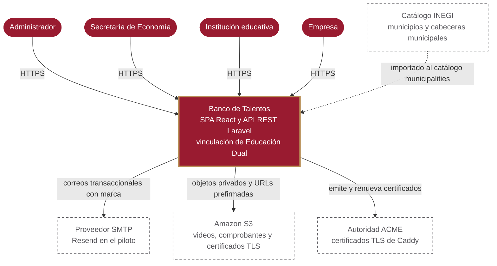

# Visión general y alcance

[Índice de la documentación técnica](../README.md)

Banco de Talentos es una plataforma web para la vinculación entre instituciones educativas, empresas y la Secretaría de Economía en el marco de la **Educación Dual**. Centraliza la información del talento estudiantil, que antes estaba dispersa entre instituciones, y organiza en un solo flujo la búsqueda, la solicitud, la respuesta y el seguimiento de cada vinculación.

## Objetivo

> Diseñar y desarrollar una plataforma web de Banco de Talentos que facilite la vinculación entre instituciones educativas, empresas y la Secretaría de Economía, permitiendo a las instituciones registrar y administrar perfiles de alumnos, y a las empresas localizar candidatos mediante criterios académicos, profesionales y geográficos para apoyar los procesos de Educación Dual.

Fuente: [Documento General](../../Banco_de_Talentos_Documento_General.md), §3.

## Actores

| Rol | Valor en el sistema | Función |
|---|---|---|
| Administrador | `ADMIN` | Gestiona las instituciones, sus cuentas, las cuentas de Administración y las de la Secretaría. Consulta el reporte ejecutivo y la bitácora, y modera los videos promocionales. No sustituye a los actores durante una vinculación. |
| Institución educativa | `INSTITUTION` | Administra solo a sus alumnos (padrón, expediente, CV y seguro facultativo). Responde las solicitudes de vinculación, conversa con la empresa, comparte la ficha ampliada del alumno y publica videos promocionales. |
| Empresa | `COMPANY` | Busca perfiles anónimos, publica Oportunidades Duales, solicita vinculaciones y, una vez aceptadas, conversa con la institución. |
| Secretaría de Economía | `SECRETARY` | Registra las empresas que ya validó y sus cuentas, crea cuentas para su propio personal y consulta el reporte ejecutivo. Nunca administra expedientes académicos ni crea cuentas `ADMIN` o `INSTITUTION`. |
| Alumno | — | **No es usuario.** Es un perfil que administra su institución. |

No hay registro público. Toda cuenta la crea otra cuenta autorizada, que queda registrada como su creadora (`users.created_by`). La persona titular establece su contraseña con un enlace de un solo uso. Los permisos de cada rol están en la [matriz de permisos](../02-dominio-y-proceso/02-matriz-de-permisos.md).

## Alcance construido

El sistema se construyó en 19 Sprints, del 24 de septiembre al 25 de noviembre de 2026. La tabla de Sprints del [README](../../../README.md) enlaza cada uno. Por área:

| Área | Capacidades | Sprints |
|---|---|---|
| Acceso y cuentas | Inicio de sesión por cookie (Sanctum). Invitación con enlace de un solo uso, por correo o entrega manual. Restablecimiento y recuperación de contraseña. Mi cuenta. Correo de acceso verificado y su cambio con confirmación. | 1, 2, 6, 14, 16, 19 |
| Instituciones y alumnos | Instituciones y sus cuentas. Padrón con búsqueda. Expediente académico y geográfico. CV normalizado (habilidades, idiomas, certificaciones, proyectos y enlaces). Seguro facultativo con comprobante. Baja lógica. | 1, 2, 3, 8, 16 |
| Empresas y Secretaría | Empresas validadas y sus cuentas. Cuentas de la Secretaría. Perfil de la organización autogestionado. Catálogo INEGI de municipios. | 4, 6, 14 |
| Búsqueda y oportunidades | Buscador de talento anónimo con radio en kilómetros, taxonomía de habilidades y búsqueda tolerante a errores. Oportunidades Duales. | 4, 5, 10, 11 |
| Vinculación | Solicitud directa empresa → institución. Respuesta, cancelación y baja. Mensajería entre las partes. Ficha compartida revocable. | 5, 6, 13, 14, 19 |
| Seguimiento | Indicadores del inicio por rol. Reporte ejecutivo y exportación CSV. Bitácora de trazabilidad. | 5, 7 |
| Promoción | Videos promocionales con transcodificación y galería de promoción dual. | 9, 14 |
| Experiencia y transparencia | Sistema de diseño con tokens de marca y modo oscuro. Apartado legal y aviso de privacidad. Correos transaccionales con marca. | 8, 12, 15, 18 |
| Infraestructura | Piloto en AWS con AMI inmutable (Packer), infraestructura como código (Terraform) y CI/CD (GitHub Actions). | 17 |

## Fuera de alcance

- **Cuentas de alumnos.** El alumno no inicia sesión. Sus datos los captura y corrige su institución.
- **La coordinación de la Educación Dual** después de aceptar una vinculación (convenios, horarios, evaluación). La plataforma ofrece la conversación y la ficha compartida, pero el proceso académico ocurre fuera.
- **Registro público y autoservicio de empresas.** La Secretaría registra solo empresas que ya validó.
- **Mediación de la Secretaría** en cada solicitud. La solicitud va directo de la empresa a la institución del alumno.

## Entornos

| Entorno | Para qué | Definición |
|---|---|---|
| Local | Desarrollo, con PostgreSQL + PostGIS, Mailpit, API, worker y Vite | `compose.yaml` |
| Pruebas | Pest y Playwright aislados en el proyecto `banco-talentos-tests` | `compose.testing.yaml`, `scripts/test-backend.sh`, `scripts/test-e2e.sh` |
| Simulación | Prueba de carga con datos sintéticos | `compose.simulation.yaml`, `scripts/simulation.sh` |
| Piloto | AWS `us-east-2`, en `https://piloto.ellukas.online` | `infra/terraform/envs/pilot/`, [runbook](../../infra/runbook-pilot.md) |

## Contexto del sistema (C4 nivel 1)

El sistema se relaciona con cuatro tipos de usuario y con cuatro sistemas externos:
- **Correo.** En el piloto sale por SMTP con Resend (`MAIL_SCHEME=smtps`, puerto 465). El proveedor no está fijo en el código: el host, el puerto y las credenciales llegan desde Terraform (`var.mail`) a SSM Parameter Store, y Laravel solo ve `MAIL_HOST`, `MAIL_PORT` y `MAIL_USERNAME`. Cambiar a otro proveedor SMTP, como Amazon SES, es solo configuración. En local, los correos los captura Mailpit.
- **Amazon S3.** Guarda los videos, los comprobantes del seguro y el respaldo de los certificados TLS. Nunca sirve objetos públicos: el navegador recibe URLs prefirmadas con caducidad.
- **Autoridad ACME.** Caddy obtiene y renueva solo el certificado TLS del dominio.
- **Catálogo INEGI.** No se consulta en tiempo de ejecución: se importó una vez a la tabla `municipalities`, y de ahí sale la ubicación de alumnos, empresas y oportunidades.

## Fuentes en el repositorio

- `CLAUDE.md` (Objetivo, Roles, Reglas de seguridad)
- `docs/Banco_de_Talentos_Documento_General.md`
- `README.md` (tabla de Sprints)
- `backend/app/Enums/UserRole.php`
- `backend/config/mail.php`, `backend/config/filesystems.php`
- `infra/terraform/envs/pilot/main.tf` (parámetros `MAIL_*`, `MEDIA_DISK`, `PRIVATE_DOCUMENTS_DISK`)
- `docs/infra/pilot-aws-plan.md` §6 (D5: Resend)
- `compose.yaml`, `compose.testing.yaml`, `compose.simulation.yaml`
