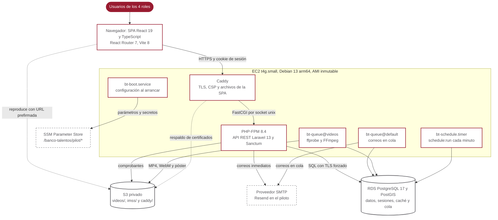

# Arquitectura: monolito modular

[Índice de la documentación técnica](../README.md)

Banco de Talentos es un **monolito modular**: una sola aplicación Laravel expone la API REST y una sola SPA de React la consume. Las dos se despliegan juntas como una versión. Los módulos se separan por dominio dentro del mismo código y la misma base de datos, no por servicios en la red. La decisión y sus consecuencias están en el [ADR-001](adr/ADR-001-monolito-modular.md).

## Módulos del backend

| Módulo | Controladores |
|---|---|
| Acceso y cuenta propia | `AuthController`, `InitialPasswordController`, `PasswordForgotController`, `InstitutionPasswordResetController`, `InstitutionSetupLinkController`, `AccountController`, `AccountEmailController` |
| Gobierno de cuentas | `InstitutionController`, `InstitutionAccountController`, `AdminAccountController`, `SecretaryAccountController`, `SetupRoleAccountController` (base abstracta de las dos anteriores) |
| Empresas y perfil de organización | `CompanyController`, `CompanyAccountController`, `OrganizationProfileController` |
| Alumnos | `StudentController`, `StudentCvController`, `StudentSocialSecurityController` |
| Catálogos | `MunicipalityController`, `SkillController` |
| Búsqueda y oportunidades | `TalentController`, `OpportunityController` |
| Vinculación | `LinkageRequestController` (empresa), `InstitutionLinkageRequestController` (institución), `LinkageMessageController`, `StudentDisclosureController` |
| Medios | `InstitutionVideoController`, `PromotionalVideoController`, `MediaController` |
| Seguimiento | `DashboardController`, `ReportController`, `AuditEventController` |

En total son 32 clases de controlador. Los demás componentes (middleware, Form Requests, Concerns, Services, Jobs y Notifications) y su relación están en [Arquitectura Laravel](../04-backend/01-arquitectura-laravel.md).

## Módulos del frontend

`frontend/src/` sigue el mismo corte por dominio:

| Grupo | Carpetas |
|---|---|
| Acceso y cuenta | `auth`, `account`, `onboarding` |
| Gobierno de cuentas | `accounts`, `admin-accounts`, `institutions`, `secretary`, `companies` |
| Alumnos y talento | `students`, `talent` |
| Vinculación y oportunidades | `linkage`, `opportunities` |
| Seguimiento | `dashboard`, `reports`, `audit` |
| Promoción y legal | `videos`, `legal` |
| Transversal | `ui` (componentes y tokens), `lib` (cliente HTTP), `pages`, `test` |

## Contenedores en tiempo de ejecución (C4 nivel 2)

En el piloto, toda la aplicación vive en **una instancia EC2** creada desde una AMI inmutable. Sus procesos son unidades de systemd:

| Proceso | Responsabilidad |
|---|---|
| **Caddy** | Termina TLS con certificados ACME. Sirve los archivos compilados de la SPA (con `try_files` hacia `index.html`) y aplica la CSP y las cabeceras de seguridad. Pasa `/api` a PHP-FPM por un socket unix. |
| **PHP-FPM 8.4** | Ejecuta Laravel, que autentica la sesión con Sanctum, valida, autoriza y persiste. |
| **`bt-queue@default`** y **`bt-queue@videos`** | Dos workers de `queue:work` sobre la cola en base de datos, con `--timeout=900`, `--tries=2` y `--max-time=3600`. El primero manda correos en cola; el segundo transcodifica video con FFmpeg. |
| **`bt-schedule.timer`** | Ejecuta `schedule:run` cada minuto. |
| **`bt-boot.service`** | Al arrancar, lee la configuración y los secretos de SSM Parameter Store, escribe el `.env` en `/run`, prepara las cachés de Laravel y, si hay migraciones pendientes, deja la aplicación en mantenimiento hasta que el despliegue las aplique. |

Todo el estado vive fuera de la instancia:
- en **RDS** (datos, sesiones, caché y cola);
- en **S3** (videos, comprobantes y respaldo de certificados);
- en **SSM** (configuración y secretos).

Por eso cada despliegue puede reemplazar la EC2 completa ([ADR-003](adr/ADR-003-infraestructura-inmutable.md)).

### Equivalencia en el entorno local

`compose.yaml` levanta los mismos papeles con Docker Compose:

| Servicio | Papel |
|---|---|
| `db` | PostgreSQL 17 + PostGIS 3.5 |
| `mailpit` | Captura los correos |
| `backend` | API de Laravel |
| `worker` | `queue:listen --queue=videos,default` |
| `frontend` | Servidor de desarrollo de Vite |

Los videos van al disco local `media`, no a S3. Cambiar de disco es configuración, no código.

## Decisiones transversales

- **Sin Redis ni Octane** durante el MVP (`CLAUDE.md`, Arquitectura). Sesiones, caché, bloqueos y cola usan PostgreSQL (`SESSION_DRIVER`, `CACHE_STORE` y `QUEUE_CONNECTION` = `database`).
- **Sesión con cookie, no tokens.** La SPA y la API comparten dominio. Sanctum autentica con la cookie de sesión y el encabezado `X-XSRF-TOKEN`, y el cliente HTTP envía `credentials: 'include'`.
- **Geolocalización en el servidor.** El cliente nunca envía coordenadas. El servidor ubica alumnos, empresas y oportunidades en la cabecera municipal del catálogo INEGI.
- **Sin eliminación física** de entidades principales. Las bajas son lógicas (`PATCH .../status`) y la API no tiene rutas `DELETE`.

## Decisiones de arquitectura (ADRs)

| ADR | Decisión |
|---|---|
| [ADR-001](adr/ADR-001-monolito-modular.md) | Monolito modular |
| [ADR-002](adr/ADR-002-packer-terraform.md) | Packer para la imagen y Terraform para la infraestructura |
| [ADR-003](adr/ADR-003-infraestructura-inmutable.md) | Infraestructura inmutable: una AMI por versión |
| [ADR-004](adr/ADR-004-vpc-sin-nat.md) | VPC sin NAT Gateway |
| [ADR-005](adr/ADR-005-oidc-github-aws.md) | OIDC entre GitHub Actions y AWS |
| [ADR-006](adr/ADR-006-privacidad-por-diseno.md) | Privacidad por diseño |

## Fuentes en el repositorio

- `CLAUDE.md` (Arquitectura)
- `backend/app/Http/Controllers/`
- `frontend/src/`
- `infra/packer/files/caddy/Caddyfile`
- `infra/packer/files/systemd/` (`bt-queue@.service`, `bt-schedule.timer`, `bt-boot.service`)
- `infra/packer/files/sbin/bt-boot.sh`
- `infra/terraform/envs/pilot/main.tf` (parámetros `SESSION_DRIVER`, `CACHE_STORE`, `QUEUE_CONNECTION`, `MEDIA_DISK`)
- `compose.yaml`
- `frontend/src/lib/http.ts`, `backend/config/sanctum.php`
