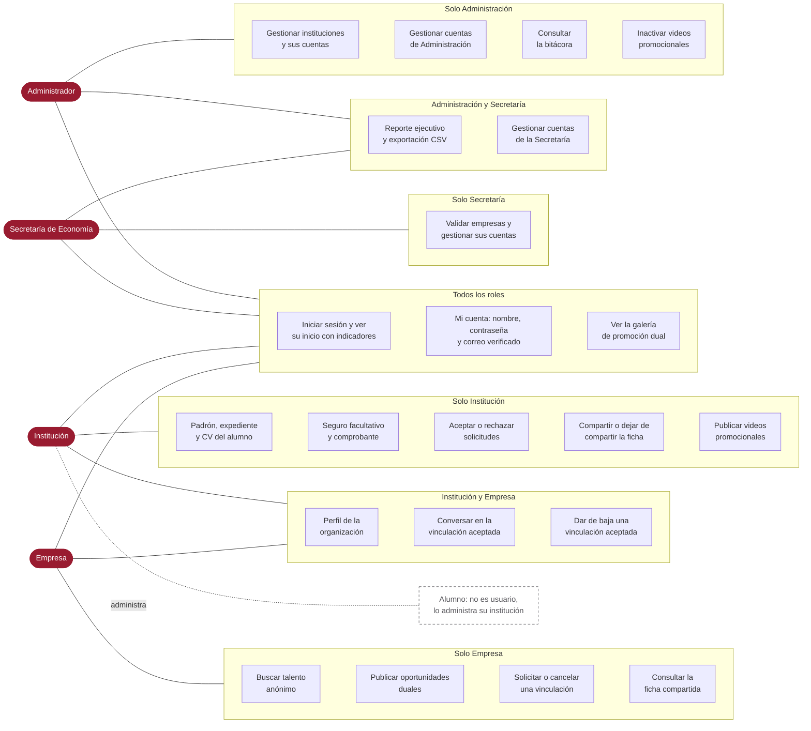
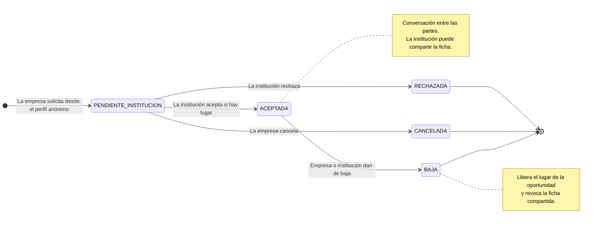

# Roles y casos de uso

> **Estado:** pendiente de redacción (T-S20-03). [Índice de la documentación técnica](../README.md)

## Contenido previsto

- Los cuatro roles y por qué el alumno no es usuario.
- Casos de uso por rol.
- Ciclo de vida de una vinculación.

## Casos de uso por rol

## Estados de una solicitud de vinculación

## Fuentes en el repositorio

- `backend/app/Enums/UserRole.php`
- `backend/routes/api.php`
- `backend/app/Enums/LinkageRequestStatus.php`
- `backend/app/Http/Controllers/InstitutionLinkageRequestController.php`
- `backend/app/Http/Controllers/LinkageRequestController.php`
