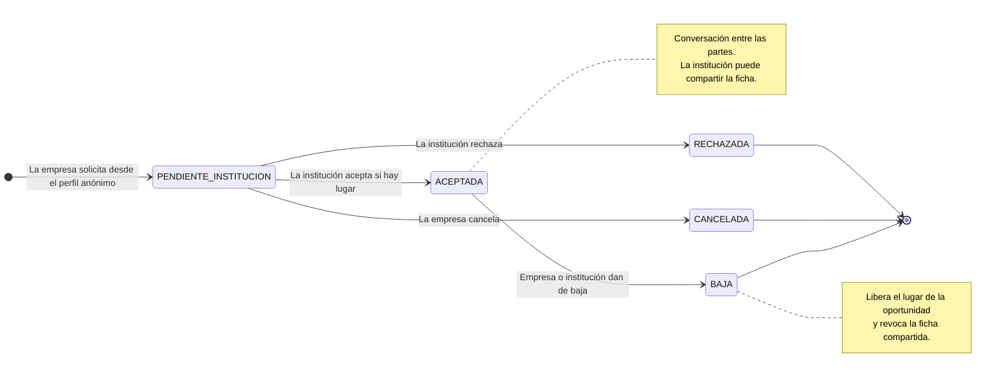

# Roles y casos de uso

[Índice de la documentación técnica](../README.md)

## Los cuatro roles

`App\Enums\UserRole` define cuatro roles: `ADMIN`, `INSTITUTION`, `COMPANY` y `SECRETARY`. El `CHECK users_role_organization` de la base amarra cada rol a su organización:
- una cuenta `COMPANY` siempre tiene `company_id` y nunca `institution_id`;
- una cuenta `INSTITUTION` nunca tiene `company_id`. Que tenga `institution_id` lo exige el middleware `institution.member` (`403` si falta);
- `ADMIN` y `SECRETARY` no pertenecen a ninguna organización.

### Por qué el alumno no es usuario

El alumno no tiene cuenta. Su institución lo registra, mantiene su expediente y su CV, y decide si comparte su ficha ampliada con una empresa. Así:
- no hay credenciales de alumnos que proteger ni flujos de recuperación para ellos;
- la institución responde por la exactitud de los datos;
- toda exposición de datos personales pasa por una decisión explícita y registrada de la institución ([ADR-006](../01-vision-general/adr/ADR-006-privacidad-por-diseno.md)).

### Quién crea cada cuenta

No hay registro público. Cada cuenta registra a su creador en `users.created_by`, y la persona titular establece su contraseña con un enlace de un solo uso. El enlace llega por correo o se entrega a mano; solo el que llega por correo verifica el buzón (D7 del Sprint 19).

| Cuenta | La crea | Ruta o comando |
|---|---|---|
| Primer `ADMIN` | Consola del servidor | `php artisan admin:bootstrap` |
| `ADMIN` | Un `ADMIN` | `POST /api/admin-accounts` |
| `INSTITUTION` | Un `ADMIN`, al crear la institución o después | `POST /api/institutions`, `POST /api/institution-accounts` |
| `SECRETARY` | Un `ADMIN` o un `SECRETARY` | `POST /api/secretary-accounts` |
| `COMPANY` | Un `SECRETARY`, al registrar la empresa validada o después | `POST /api/companies`, `POST /api/companies/{company}/accounts` |

Ningún rol crea cuentas de un rol con más alcance: la Secretaría nunca crea cuentas `ADMIN` ni `INSTITUTION`, y nadie crea cuentas de alumno.

## Casos de uso por rol

Los casos de uso salen de los grupos de rutas de `routes/api.php` y de su middleware `role:`. La [matriz de permisos](02-matriz-de-permisos.md) los detalla por ruta.

| Rol | Casos de uso principales |
|---|---|
| Todos | Iniciar sesión. Ver su inicio con indicadores de su cuenta y su organización. Mi cuenta: nombre, contraseña y correo de acceso verificado. Ver la galería de promoción dual. |
| Administrador | Gestionar instituciones (alta, edición, baja lógica) y sus cuentas. Gestionar cuentas de Administración (siempre queda al menos un `ADMIN` activo y nadie se inactiva a sí mismo). Gestionar cuentas de la Secretaría. Consultar la bitácora. Inactivar videos promocionales (moderación). Reporte ejecutivo y su CSV. |
| Secretaría de Economía | Registrar empresas validadas, editarlas, darlas de baja y gestionar sus cuentas. Gestionar cuentas de su personal. Reporte ejecutivo y su CSV. |
| Institución | Padrón con búsqueda. Expediente académico y geográfico. CV normalizado. Seguro facultativo con comprobante. Bandeja de solicitudes con respuesta, exportación CSV y baja. Conversación. Compartir o dejar de compartir la ficha. Videos promocionales. Perfil de su organización. |
| Empresa | Buscar talento anónimo por carrera, habilidades, idiomas, certificaciones y distancia. Publicar Oportunidades Duales y darlas de baja. Solicitar, cancelar o dar de baja vinculaciones. Conversar. Consultar la ficha compartida. Perfil de su organización. |

Para operar, la organización debe estar activa (`COMPANY_INACTIVE`, `INSTITUTION_INACTIVE`). Además, publicar oportunidades, solicitar vinculaciones, responderlas, registrar alumnos y subir videos exigen el perfil mínimo de la organización (`COMPANY_PROFILE_INCOMPLETE` o `INSTITUTION_PROFILE_INCOMPLETE`, con código `422`).

## Ciclo de vida de una vinculación

Una solicitud de vinculación une una empresa, una de sus oportunidades y un alumno, identificado por su `public_id`. Va dirigida a la institución del alumno, sin mediación de la Secretaría.

| Transición | Quién | Reglas |
|---|---|---|
| Crear (`PENDIENTE_INSTITUCION`) | Empresa | La oportunidad debe estar activa, con lugares disponibles. Un índice único parcial impide otra solicitud pendiente o aceptada para la misma empresa, alumno y oportunidad (`linkage_requests_active_unique`). El mensaje no admite datos de contacto. |
| Aceptar (`ACEPTADA`) | Institución | Bloquea la oportunidad (`FOR UPDATE`) y acepta solo si las aceptadas siguen siendo menos que `vacancies`. Registra quién respondió y cuándo. |
| Rechazar (`RECHAZADA`) | Institución | Mensaje de respuesta opcional, sin datos de contacto. |
| Cancelar (`CANCELADA`) | Empresa | Solo desde `PENDIENTE_INSTITUCION`. |
| Dar de baja (`BAJA`) | Empresa o institución | Solo desde `ACEPTADA`, con motivo obligatorio. Libera el lugar de la oportunidad, revoca la ficha compartida (`revoked_reason = termination`) y deja la conversación en solo lectura. |

Mientras la solicitud está `ACEPTADA`, las partes conversan (`linkage_messages`, mensajes inmutables por trigger) y la institución puede compartir la ficha ([Ficha compartida](../03-datos/03-ficha-compartida.md)). Los demás estados son finales.

## Fuentes en el repositorio

- `backend/app/Enums/UserRole.php`, `backend/app/Enums/LinkageRequestStatus.php`
- `backend/routes/api.php`, `backend/routes/web.php`
- `backend/app/Console/Commands/AdminBootstrap.php`
- `backend/app/Models/User.php` (`accessRestriction`)
- `backend/app/Http/Controllers/Concerns/RequiresOperableCompany.php`, `RequiresOperableInstitution.php`, `TerminatesLinkage.php`
- `backend/app/Http/Controllers/LinkageRequestController.php`, `InstitutionLinkageRequestController.php`, `LinkageMessageController.php`
- `backend/database/migrations/2026_10_22_000002_add_company_id_to_users_table.php` (`users_role_organization`)
- `backend/database/migrations/2026_10_28_000001_create_linkage_requests_table.php`, `2026_11_20_000002_add_termination_to_linkage_requests.php`
- `docs/sprint-19.md` (D7)
