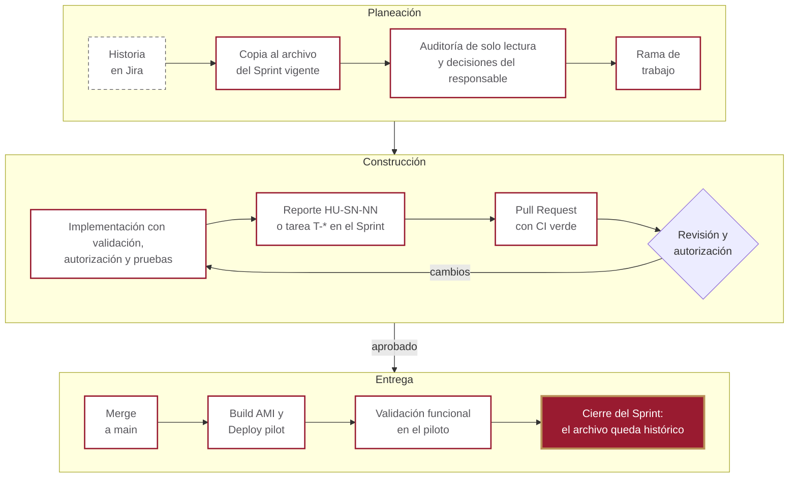

# Metodología: Sprints, PRs y CI/CD

[Índice de la documentación técnica](../README.md)

El proyecto avanza por Sprints cortos. El primer commit es del 24 de septiembre de 2026 y el Sprint 19 cerró el 25 de noviembre de 2026; el Sprint 20 produce esta documentación. La disciplina del proceso vive en `CLAUDE.md` (y su copia `AGENTS.md`), que define las reglas para cualquier persona o agente que modifique el repositorio.

## Fuente de verdad del alcance

- **Las historias se gestionan en Jira.** Solo se consideran aprobadas las que el responsable copia en el archivo del **Sprint vigente** (`docs/sprint-N.md`).
- **El Sprint vigente** lo declara `CLAUDE.md`. Mientras dure, su archivo es la única fuente de verdad; los Sprints anteriores son históricos y no autorizan desarrollo nuevo.
- **Antes de implementar:**
  1. se verifica que la historia exista en el Sprint vigente;
  2. se revisan sus criterios de aceptación;
  3. se limitan los cambios a su alcance.

  Si algo no está en el Sprint, se detiene el trabajo y se pide confirmación.
- **Las decisiones del responsable** quedan escritas en el Sprint con identificador (`D1`, `D2`…). Así un Sprint posterior puede citar la decisión exacta; por ejemplo, la excepción de privacidad «Sprint 19, D1».

## Historias y tareas técnicas

| Tipo | Identificador | Dónde se documenta |
|---|---|---|
| Historia de usuario | `HU-SN-NN` (por ejemplo, `HU-S11-03`) | Su reporte `docs/HU-SN-NN.md`, enlazado desde el Sprint en «Diseño técnico y verificación». Hay 64 reportes. |
| Tarea técnica | `T-SN-NN` (por ejemplo, `T-S17-09`) | Dentro del archivo del Sprint |

Cada historia debe:
1. cumplir sus criterios de aceptación;
2. tener validaciones backend (Form Requests y `CHECK` en la base);
3. tener autorización backend cuando corresponda;
4. incluir pruebas automatizadas relevantes (Pest, Vitest y, en los flujos completos, Playwright);
5. mantener el código sencillo;
6. terminar con su reporte: alcance, contrato, decisiones, limitaciones, archivos y cobertura de cada criterio. El modelo es `docs/HU-S11-03.md`.

## Ciclo de un Sprint

1. **Auditoría de solo lectura.** Antes de escribir código se revisa `main` y se registra un diagnóstico en el Sprint. Las preguntas abiertas se resuelven como decisiones del responsable.
2. **Ramas por trabajo:**
   - historias o tareas: `feat/…`, por ejemplo `feat/s19-student-disclosure`;
   - correcciones: `fix/…`;
   - documentación: `docs/…`;
   - mantenimiento: `chore/…`.
3. **Commits con prefijo de tipo.** En `main` predominan `feat` (120), `docs` (32), `chore` (18), `fix` (16) y `test` (14), más 78 commits de fusión.
4. **Pruebas antes de integrar.**
   - `sh scripts/test-backend.sh` (Pest sobre PostgreSQL temporal) y `sh scripts/test-e2e.sh` (Playwright con la API real y Mailpit) se ejecutan **siempre en secuencia**, porque comparten el proyecto de Compose `banco-talentos-tests`.
   - Vitest, ESLint, `tsc -b` y la compilación corren en el servicio de frontend.
5. **Pull Request con CI verde.** Desde el Sprint 17 todo cambio entra por PR en GitHub (#1 a #14 al cierre del Sprint 19). Hasta el Sprint 16 la integración era local: los Sprints 1 a 4 iban directo a `main`, y desde el Sprint 5 (HU-S5-01) cada historia tenía su rama y se fusionaba con un commit de fusión.
6. **Revisión y autorización del responsable.** Nadie fusiona su propio trabajo sin esa autorización.
7. **Despliegue** con **Build AMI** y **Deploy pilot**, y validación funcional en el piloto. Un Sprint puede no desplegar: los Sprints 18 y 19 se desplegaron juntos con una sola AMI.
8. **Cierre.** Un PR de cierre registra en el Sprint el despliegue (ejecución, AMI e instancia) y la validación. El archivo queda como histórico.

## CI/CD

El detalle de cada workflow está en [GitHub Actions y CI/CD](../06-infraestructura/04-github-actions.md). En resumen:

| Workflow | Disparador | Qué hace |
|---|---|---|
| `ci.yml` | Cada PR, cada push a `main` y manual | Frontend (`npm ci`, ESLint, `tsc -b`, Vitest, build y `npm audit --audit-level=high`), Pint con `composer audit`, y Pest. Playwright solo en ejecución manual con `e2e=true`. |
| `build-ami.yml` | Tags `v*` y manual | Reutiliza `ci.yml`, arma el artefacto de la versión y construye la AMI con Packer. |
| `deploy-pilot.yml` | Manual | `plan` → aprobación del entorno `pilot` → `apply`, migraciones y prueba de humo. |

## Fuentes en el repositorio

- `CLAUDE.md` (Desarrollo, Desarrollo por Sprint, Ejecución de Pruebas), `AGENTS.md`
- `docs/sprint-1.md` a `docs/sprint-20.md`, `docs/HU-*.md` (64 reportes), `docs/HU-S11-03.md`
- `README.md` (tabla de Sprints)
- `scripts/test-backend.sh`, `scripts/test-e2e.sh`
- `.github/workflows/ci.yml`, `.github/workflows/build-ami.yml`, `.github/workflows/deploy-pilot.yml`
- Historial de `git log main` y de los PRs #1 a #14 en GitHub
