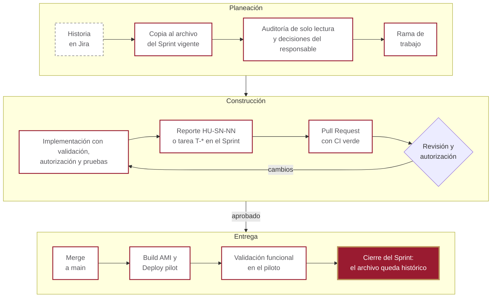

# Metodología: Sprints, PRs y CI/CD

> **Estado:** pendiente de redacción (T-S20-03). [Índice de la documentación técnica](../README.md)

## Contenido previsto

- Historias en Jira y archivo del Sprint vigente.
- Reportes `HU-SN-NN` y tareas `T-*`.
- Flujo de ramas, PRs y despliegue.

## Flujo de Sprints y Pull Requests

## Fuentes en el repositorio

- `CLAUDE.md` (Desarrollo)
- `docs/sprint-*.md`
- `docs/HU-*.md`
