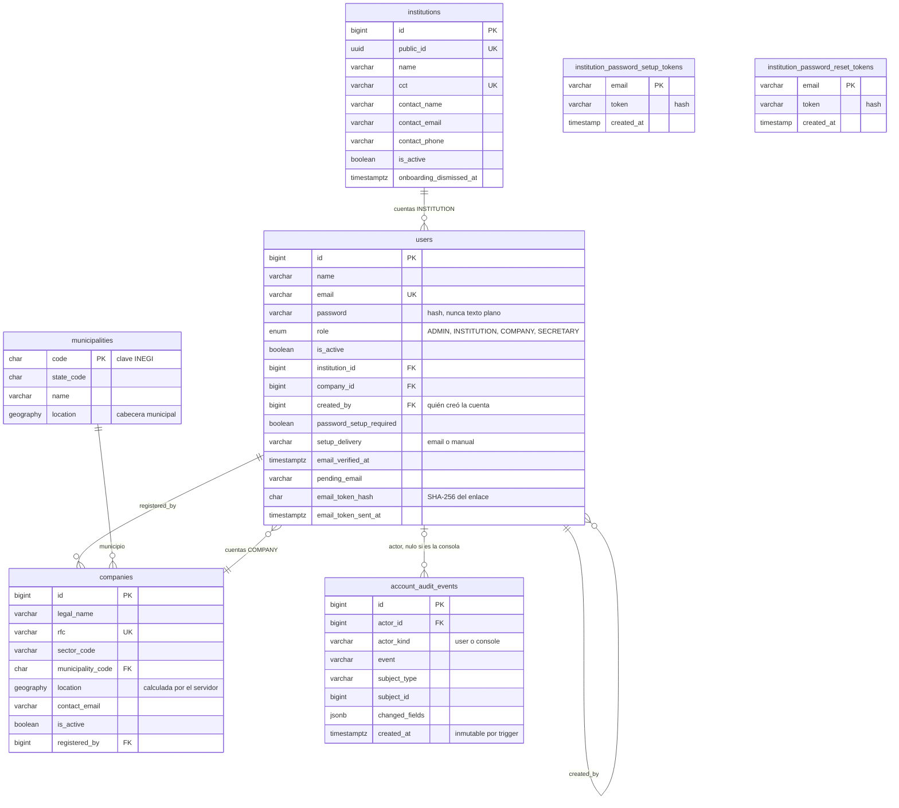
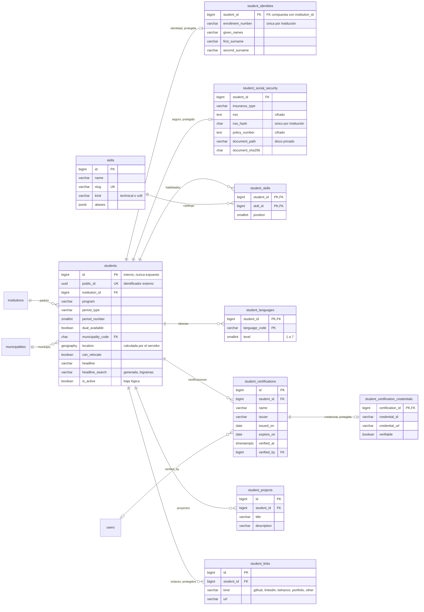
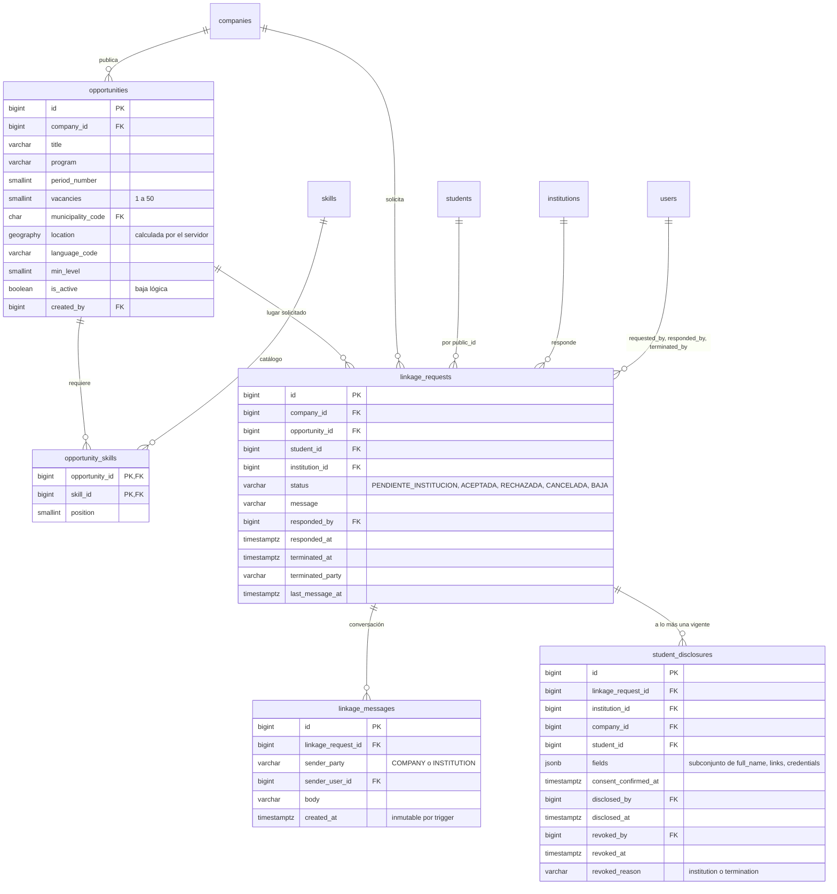
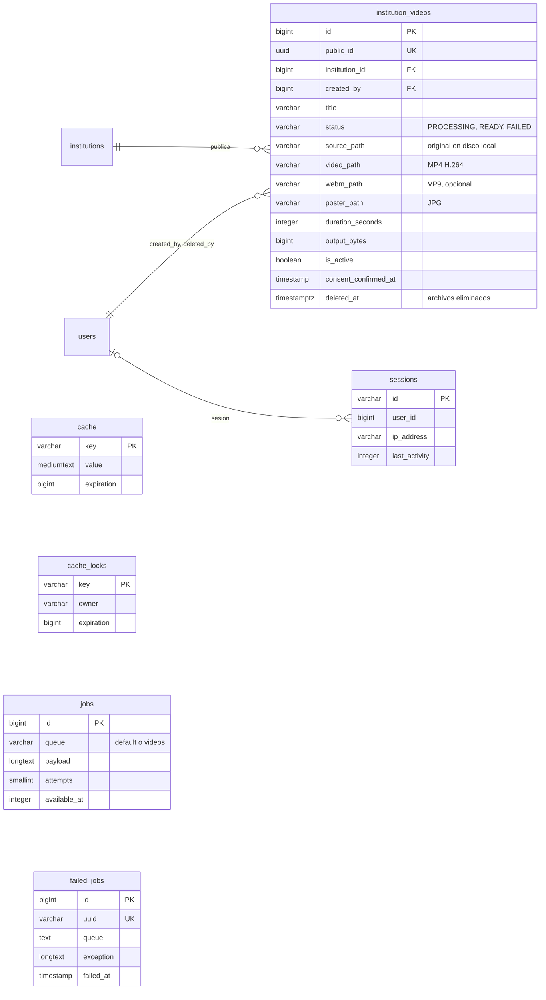

# Modelo de datos

> **Estado:** pendiente de redacción (T-S20-04). [Índice de la documentación técnica](../README.md)

## Contenido previsto

- 28 tablas en 4 dominios, extraídas de las 46 migraciones (incluidas las 9 de SQL crudo).
- Restricciones `CHECK`, FK compuestas `(student_id, institution_id)`, índices parciales y triggers de inmutabilidad.
- PostGIS (`geography(Point, 4326)`), `pg_trgm` y `fuzzystrmatch`.

## Cuentas y organizaciones

## Alumnos y CV

## Vinculación

## Medios y tablas de soporte

## Fuentes en el repositorio

- `backend/database/migrations/`
