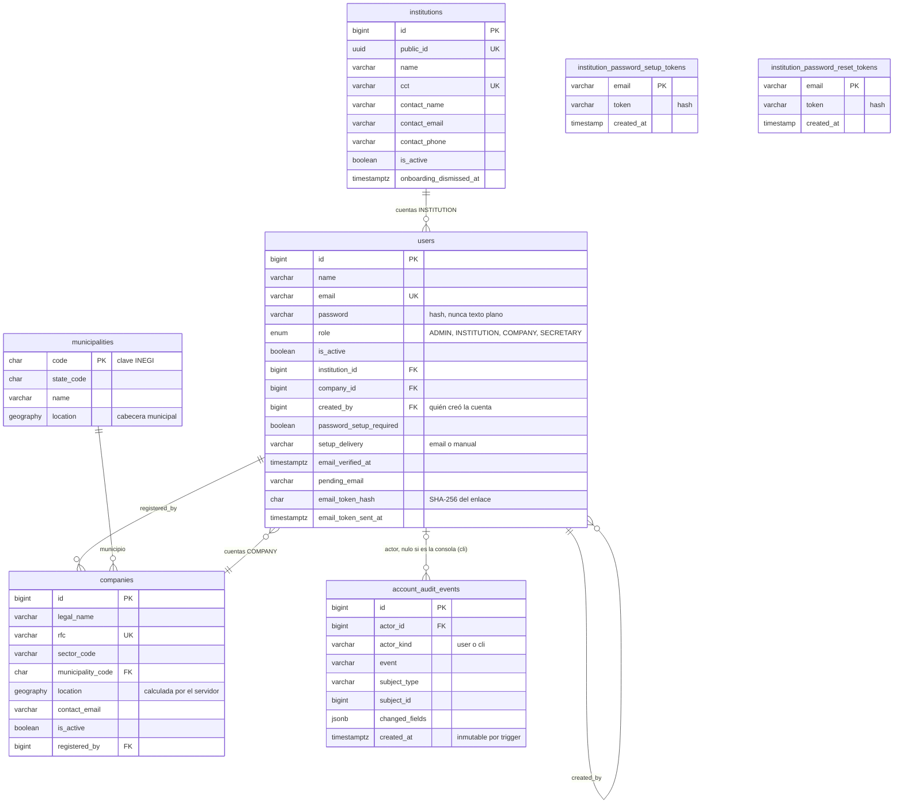
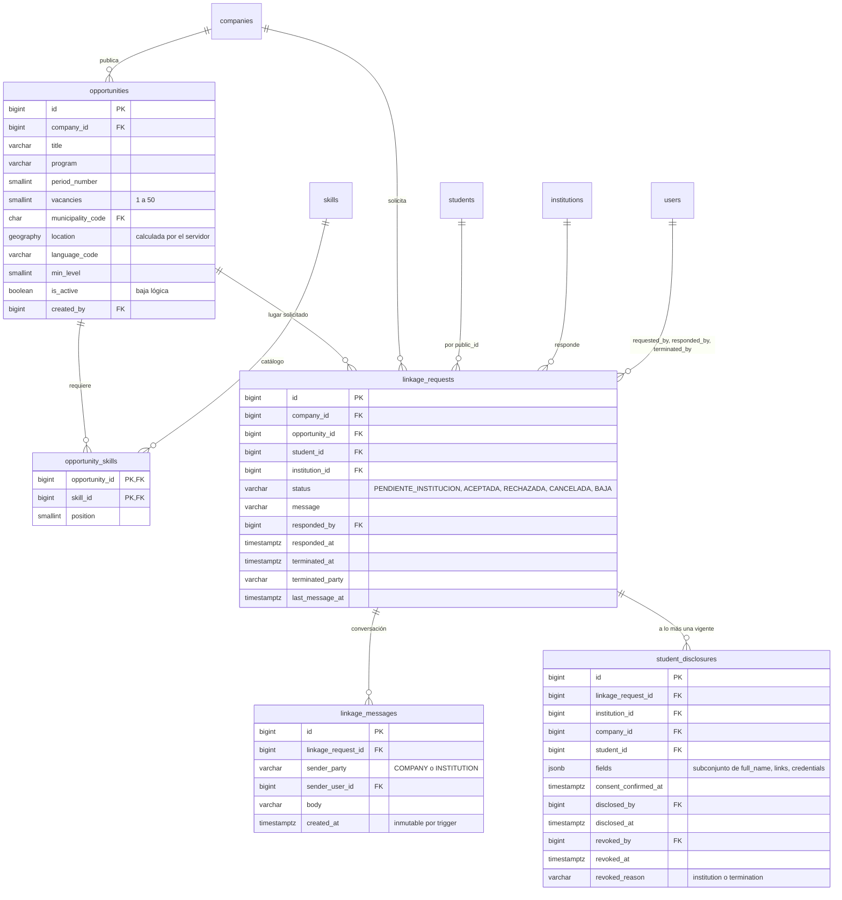
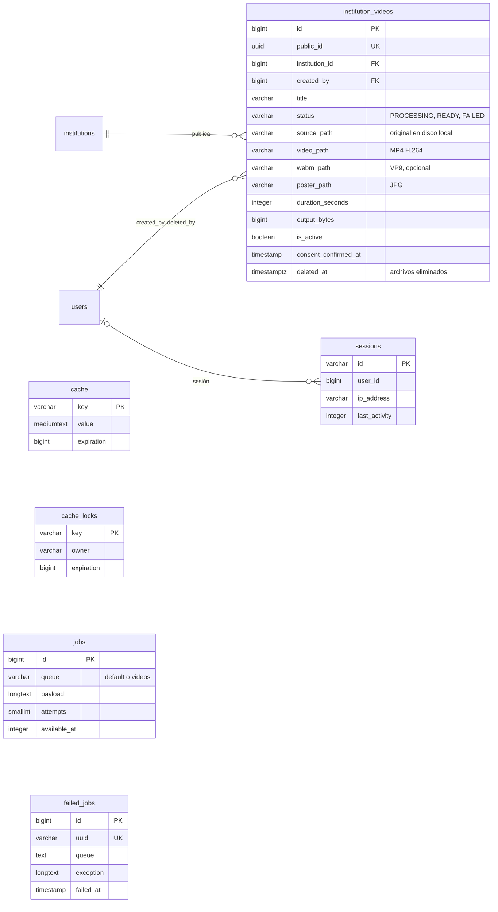

# Modelo de datos

[Índice de la documentación técnica](../README.md)

El esquema sale de **46 migraciones** en `backend/database/migrations/`, del 26 de septiembre al 25 de noviembre de 2026, y define **28 tablas** en PostgreSQL 17 con PostGIS.

**9 tablas se crean con SQL crudo** (`DB::statement(<<<SQL CREATE TABLE …)`) en lugar de `Schema::create`:
- `companies`, `municipalities`, `opportunities`, `opportunity_skills`, `linkage_requests`, `linkage_messages`, `institution_videos`, `account_audit_events` y `student_disclosures`.

Se usó SQL directo porque esas tablas necesitan cosas que el constructor de esquemas no expresa, o expresa a medias:
- columnas `geography(Point, 4326)`;
- `CHECK` con expresiones regulares o con varias columnas relacionadas;
- índices únicos parciales;
- triggers de inmutabilidad.

Otras tablas creadas con `Schema::create` reciben después `CHECK`, índices o columnas por `ALTER TABLE` en SQL. Por eso esta documentación se extrajo leyendo cada migración completa, no solo las llamadas a `Schema::create`.

## Tablas por dominio

| Dominio | Tablas | Diagrama |
|---|---|---|
| Cuentas y organizaciones (7) | `users`, `institutions`, `companies`, `municipalities`, `account_audit_events`, `institution_password_setup_tokens`, `institution_password_reset_tokens` | D05a |
| Alumnos y CV (10) | `students`, `student_identities`, `student_social_security`, `skills`, `student_skills`, `student_languages`, `student_certifications`, `student_certification_credentials`, `student_projects`, `student_links` | D05b |
| Vinculación (5) | `opportunities`, `opportunity_skills`, `linkage_requests`, `linkage_messages`, `student_disclosures` | D05c |
| Medios y soporte (6) | `institution_videos`, `sessions`, `cache`, `cache_locks`, `jobs`, `failed_jobs` | D05d |

Los diagramas muestran las columnas que explican cada relación y cada regla, no todas. Se omiten `created_at` y `updated_at`, que casi todas las tablas tienen. Cuando una entidad de otro dominio aparece solo como referencia, se dibuja sin columnas.

## Convenciones del esquema

- **Claves primarias.** `bigserial id` por omisión. Las excepciones son:
  - la clave INEGI en `municipalities.code`;
  - claves compuestas en las tablas puente (`student_skills`, `student_languages`, `opportunity_skills`);
  - `certification_id` en `student_certification_credentials`;
  - el correo en las dos tablas de enlaces de contraseña;
  - la clave natural de Laravel en `sessions`, `cache` y `cache_locks`.
- **Identificadores públicos.** `students.public_id`, `institutions.public_id` e `institution_videos.public_id` son `uuid` con `DEFAULT gen_random_uuid()` y restricción `UNIQUE`. Las vistas externas y las URLs los usan en lugar del `id` interno.
- **Integridad referencial.** Las FK usan `ON DELETE RESTRICT`, porque no hay borrado físico de entidades principales. Hay dos excepciones:
  - `student_certifications.verified_by` es `SET NULL`;
  - `student_certification_credentials` se borra en cascada con su certificación, cuando la institución reemplaza la lista de certificaciones del CV.
- **Pertenencia en la propia base.**
  - `student_identities`, `student_social_security` y las cinco tablas del CV (habilidades, idiomas, certificaciones, proyectos y enlaces) guardan `institution_id` y referencian `students (id, institution_id)` con una FK compuesta. La función `ownedByStudent()` de la migración la aplica a las tablas del CV.
  - Las credenciales referencian `student_certifications (id, student_id, institution_id)`.
  - Así, una fila nunca puede quedar ligada a un alumno de otra institución.
- **Valores cerrados.** Son `varchar` con `CHECK`; por ejemplo, los estados de `linkage_requests` y de `institution_videos`, los tipos de enlace o el nivel de idioma de 1 a 7.
- **`CHECK` que amarran columnas relacionadas:**
  - `linkage_requests_response_pair_check`: quién respondió y cuándo van juntos;
  - `linkage_requests_termination_check`: `BAJA` sí y solo si hay fecha, autor, parte y motivo no vacío;
  - `users_email_token_check`: el hash del enlace y su fecha van juntos, y un correo pendiente siempre tiene enlace;
  - `student_social_security_nss_pair_check`: el NSS cifrado y su índice ciego van juntos;
  - `student_disclosures_fields_check`: `fields` es un arreglo no vacío dentro de `["full_name", "links", "credentials"]`;
  - `account_audit_events_actor_check`: un actor `user` tiene `actor_id`; uno `cli` no.
- **Índices únicos parciales:**
  - `linkage_requests_active_unique`: una sola solicitud `PENDIENTE_INSTITUCION` o `ACEPTADA` por empresa, alumno y oportunidad;
  - `student_disclosures_active_unique`: una sola ficha vigente por vinculación;
  - `users_email_token_hash_unique`: un hash de enlace de correo no se repite.
- **Triggers de inmutabilidad:**
  - `linkage_messages_immutable` y `account_audit_events_immutable` rechazan cualquier `UPDATE` o `DELETE`;
  - `student_disclosures_append_only` rechaza el `DELETE` y solo admite un `UPDATE`: llenar una vez las columnas de revocación sin tocar las demás.
- **Geografía:**
  - `municipalities`, `students`, `companies` y `opportunities` tienen `location geography(Point, 4326)`;
  - `students`, `companies` y `opportunities` la indexan con GiST;
  - el cliente nunca la envía: el servidor la copia de la cabecera municipal del catálogo.
- **Búsqueda de texto:**
  - `students.headline_search` y `program_search` son columnas generadas (`GENERATED ALWAYS AS … STORED`) con la función `IMMUTABLE` `talent_search_text()` (minúsculas, sin acentos), indexadas con GIN de trigramas;
  - `skills` tiene `aliases jsonb` (GIN) y un índice GiST de trigramas sobre `slug`;
  - las extensiones son `pg_trgm` y `fuzzystrmatch`.
- **Fechas.** Las tablas más recientes usan `timestamptz`. Las primeras usan el `timestamp(0)` de Laravel. La aplicación trabaja en UTC, así que la diferencia no altera los valores.

## Cuentas y organizaciones (D05a)

| Tabla | Notas |
|---|---|
| `users` | Una fila por cuenta de los cuatro roles. `password` guarda solo el hash. `created_by` registra quién creó la cuenta. `password_setup_required` y `setup_delivery` (`email` o `manual`) describen la activación. `email_verified_at`, `pending_email`, `email_token_hash` (SHA-256) y `email_token_sent_at` soportan la verificación y el cambio del correo (Sprint 19). |
| `institutions` | `cct` único (Clave de Centro de Trabajo). Los datos de contacto son opcionales desde el Sprint 16: la institución completa su perfil, y `onboarding_dismissed_at` registra si lo pospuso. |
| `companies` | `rfc` único con formato validado por `CHECK`. Registra el sector, el municipio y la ubicación calculada. `registered_by` es la cuenta de la Secretaría que la registró. Perfil autogestionado desde el Sprint 14. |
| `municipalities` | Catálogo INEGI: 2,478 municipios con su clave (`code`, que empieza con la clave del estado) y el punto de su cabecera. Se carga en la propia migración desde `backend/database/data/inegi/municipios.csv` (`MunicipalityCatalog::sync()`). |
| `account_audit_events` | Eventos de cuenta inmutables. `event` admite 9 valores: `account_updated`, `password_changed`, `organization_profile_updated`, `company_invited`, `institution_invited`, `admin_bootstrapped`, `password_reset_issued`, `email_changed` y `account_status_changed`. `changed_fields` guarda solo los nombres de los campos, nunca sus valores. |
| `institution_password_setup_tokens`, `institution_password_reset_tokens` | Enlaces de un solo uso para establecer y restablecer la contraseña de cualquier rol. El nombre es histórico, de cuando solo había cuentas institucionales. Guardan el hash del token, por correo. |

### `users_role_organization`: lo que exige la base y lo que exige la aplicación

El `CHECK users_role_organization` admite tres formas:
- `COMPANY` con `company_id` y sin `institution_id`;
- `INSTITUTION` sin `company_id`;
- `ADMIN` o `SECRETARY` sin ninguna de las dos.

**La base no exige `institution_id` en una cuenta `INSTITUTION`.** Lo exige la aplicación: el middleware `institution.member` responde `403` si falta, y la cuenta institucional siempre se crea dentro de su institución (`InstitutionAccounts`). La restricción se agregó como `NOT VALID` y se validó solo después de comprobar que no hubiera filas que la violaran.

## Alumnos y CV (D05b)

| Tabla | Notas |
|---|---|
| `students` | Perfil sin datos que identifiquen al alumno: carrera, periodo, disponibilidad dual, municipio y movilidad, titular del CV y baja lógica (`is_active`). `id` nunca sale de la institución; `public_id` es el identificador externo. |
| `student_identities` | Matrícula, única por institución sin distinguir mayúsculas, y nombre. **Protegida:** solo la ve su institución. El nombre completo sale únicamente por la ficha compartida. |
| `student_social_security` | Tipo de seguro (`IMSS` o privado), NSS y póliza **cifrados** (cast `encrypted`), `nss_hash` como índice ciego para la unicidad por institución, y metadatos del comprobante PDF (ruta, nombre, tamaño, SHA-256 y fecha). **Protegida:** nunca sale de la institución. |
| `skills` | Taxonomía de habilidades técnicas y blandas, con alias. Se carga con `php artisan skills:seed` desde `backend/database/data/skills/top_skills.csv` (820 habilidades). |
| `student_skills`, `student_languages`, `student_projects` | Listas ordenadas del CV (`position`). Se reemplazan completas al guardar. |
| `student_certifications` | Certificación, emisor y vigencia. La institución puede verificarla (`verified_at` y `verified_by`); `verified_by` nunca se expone fuera de ella. |
| `student_certification_credentials` | Identificador y URL de la credencial verificable. **Protegida:** sale únicamente por la ficha compartida. |
| `student_links` | Enlaces externos (GitHub, LinkedIn, Behance, portafolio y otro), únicos por alumno sin distinguir mayúsculas. **Protegida:** sale únicamente por la ficha compartida. |

## Vinculación (D05c)

| Tabla | Notas |
|---|---|
| `opportunities` | Oportunidad Dual de una empresa: carrera, periodo, lugares (`vacancies` de 1 a 50), ubicación, idioma con nivel mínimo opcional (ambos o ninguno) y baja lógica. `created_by` es la cuenta que la publicó. |
| `opportunity_skills` | Habilidades requeridas, en orden. |
| `linkage_requests` | La solicitud y su estado. Guarda quién respondió y la respuesta, la baja (fecha, autor, parte y motivo) y las marcas de la conversación (`last_message_at`, último mensaje leído por cada parte y avisos por correo enviados). `institution_id` está desnormalizado a propósito: la bandeja institucional filtra por él sin unir con `students`. |
| `linkage_messages` | Mensajes de la conversación con la parte emisora y la cuenta. Inmutables por trigger y con el cuerpo no vacío (`CHECK`). |
| `student_disclosures` | Ficha compartida. Guarda los grupos compartidos, el consentimiento, quién y cuándo, y la revocación (quién, cuándo y por qué: `institution` o `termination`). Ver [Ficha compartida](03-ficha-compartida.md). |

## Medios y tablas de soporte (D05d)

| Tabla | Notas |
|---|---|
| `institution_videos` | Video promocional. Guarda el estado (`PROCESSING`, `READY` o `FAILED`), las rutas del original, el MP4, el WebM opcional y el póster, las medidas y los bytes, el consentimiento de las personas que aparecen y la eliminación de archivos (`deleted_at`, `deleted_by`). Los `CHECK` exigen rutas y medidas en `READY` y motivo en `FAILED`. Ver [Colas y procesamiento de video](../04-backend/03-colas-y-video.md). |
| `sessions` | Sesiones de Laravel (`SESSION_DRIVER=database`). Viven en la base para sobrevivir al reemplazo de la instancia. |
| `cache`, `cache_locks` | Caché y bloqueos de Laravel (`CACHE_STORE=database`). |
| `jobs`, `failed_jobs` | Cola en base de datos, con las colas `default` y `videos`, y los trabajos fallidos con su excepción. |

## Bitácora de trazabilidad

La bitácora del Administrador (`GET /api/audit-events`) no tiene una tabla única. **Une en una consulta paginada** dos fuentes:
- **Columnas de autoría** que ya existen en las tablas:

  | Evento | Origen |
  |---|---|
  | `account_created` | `users.created_by` |
  | `company_registered` | `companies.registered_by` |
  | `opportunity_created` | `opportunities.created_by` |
  | `linkage_requested` | `linkage_requests.requested_by` |
  | `linkage_responded` | `linkage_requests.responded_by` |
  | `student_disclosed` y `student_disclosure_revoked` | `student_disclosures.disclosed_by` y `student_disclosures.revoked_by` |
- **Los 9 eventos inmutables** de `account_audit_events`.

Cada evento se describe con una lista explícita de campos públicos. Nunca incluye contraseñas, tokens, hashes, NSS, la identidad del alumno ni los valores que cambiaron.

## Fuentes en el repositorio

- `backend/database/migrations/` (46 migraciones), en particular:
  - `2026_10_13_000000_create_students_tables.php`, `2026_10_16_000000_create_student_social_security_table.php`, `2026_10_16_000001_create_student_cv_tables.php`;
  - `2026_10_21_000001_create_municipalities_table.php`, `2026_10_22_000001_create_companies_table.php`, `2026_10_22_000002_add_company_id_to_users_table.php`;
  - `2026_10_28_000000_create_opportunities_table.php`, `2026_10_28_000001_create_linkage_requests_table.php`, `2026_11_17_000001_create_linkage_messages_table.php`;
  - `2026_11_18_000002_create_account_audit_events_table.php`, `2026_11_22_000001_add_console_actor_to_account_audit_events.php`, `2026_11_22_000002_make_institution_profile_optional.php`;
  - `2026_11_12_000001_add_search_text_to_students_table.php`, `2026_11_24_000001_add_email_verification_to_users_table.php`, `2026_11_25_000001_create_student_disclosures_table.php`
- `backend/app/Support/MunicipalityCatalog.php`, `backend/database/data/inegi/`
- `backend/app/Console/Commands/SeedSkills.php`, `backend/database/data/skills/`
- `backend/app/Models/AccountAuditEvent.php`, `backend/app/Http/Controllers/AuditEventController.php`
- `backend/app/Http/Controllers/StudentCvController.php`
