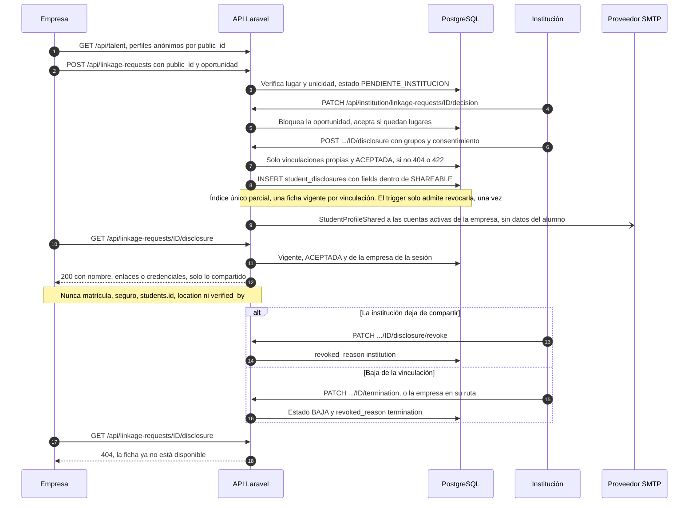

# Ficha compartida: lista blanca revocable

[Índice de la documentación técnica](../README.md)

La ficha compartida es **la única excepción** a la regla de privacidad que prohíbe entregar datos identificables del alumno a una empresa ([ADR-006](../01-vision-general/adr/ADR-006-privacidad-por-diseno.md)). La decidió el responsable en el Sprint 19 (D1 a D5) y la implementan las tareas T-S19-05 a T-S19-08.

Tras aceptar una vinculación, la institución puede compartir con esa empresa una ficha ampliada del alumno. Lo hace por decisión explícita, con el consentimiento del alumno o su tutor, y puede revocarla.

## Qué se puede compartir

`App\Models\StudentDisclosure::SHAREABLE` es la lista blanca, y el `CHECK student_disclosures_fields_check` de la base la repite:

| Grupo | Datos que entrega | Origen |
|---|---|---|
| `full_name` | Nombre completo: nombres y apellidos | `student_identities` (solo `given_names`, `first_surname` y `second_surname`) |
| `links` | Enlaces externos con su tipo, en orden | `student_links` (`kind` y `url`) |
| `credentials` | Certificación, emisor, identificador y URL de la credencial | `student_certifications` (`name` e `issuer`) unida con `student_certification_credentials` (`credential_id` y `credential_url`) |

**Nunca** se comparten la matrícula (`enrollment_number`), ningún dato del seguro (`student_social_security`), `students.id`, `location` ni `verified_by`. Cada consulta de `sharedProfile()` nombra sus columnas, así que ninguna lee esos datos ni por accidente.

Además, una URL que no empiece con `http://` o `https://` (por ejemplo, `javascript:`) no sale hacia la empresa. Los enlaces con otro esquema se omiten, y las credenciales salen sin su URL.

## Reglas

| Regla | Dónde se cumple |
|---|---|
| Solo en una vinculación `ACEPTADA` | `StudentDisclosureController::institutionLinkage()`; si no, `422`. Al leer, la empresa obtiene `404`. |
| Solo la institución dueña comparte o revoca | El controlador filtra por `institution_id` de la sesión con `FOR UPDATE`; una vinculación ajena responde `404`. |
| Solo la empresa de la vinculación la lee | `show()` filtra por `company_id` de la sesión; cualquier otro caso responde `404`. |
| Al menos un grupo, todos de la lista y sin repetir | `ShareStudentProfileRequest`: `fields` entre 1 y 3 elementos, `distinct` y `Rule::in(SHAREABLE)`. Cualquier campo extra del cuerpo es un error. |
| Consentimiento obligatorio | `consent` debe ser `accepted`. Se registra la fecha en `consent_confirmed_at` (D3). |
| Una ficha vigente por vinculación | Índice único parcial `student_disclosures_active_unique` (`WHERE revoked_at IS NULL`). Para cambiar los grupos hay que dejar de compartir y volver a compartir. |
| Revocable por la institución | `PATCH …/disclosure/revoke` llena `revoked_by`, `revoked_at` y `revoked_reason = institution`. |
| La baja de la vinculación la revoca | `TerminatesLinkage` pasa la vinculación a `BAJA` y revoca la ficha en **la misma transacción**, con `revoked_reason = termination` (D4). |
| Historial protegido | El trigger `student_disclosures_append_only` impide borrar filas, modificar lo que se compartió o revocar dos veces. |
| Límite de peticiones | `throttle:linkage-disclosure` al compartir y al revocar. |

## Datos en vivo

La tabla `student_disclosures` **no guarda una copia** de los datos del alumno. Guarda qué grupos se compartieron, el consentimiento y la autoría. `sharedProfile()` lee los datos en el momento de cada consulta:
- si la institución corrige un enlace, la empresa ve el valor actualizado;
- en cuanto la ficha se revoca, la empresa deja de ver todo.

## Flujo completo

1. La empresa encuentra al alumno en el buscador anónimo (`public_id`) y solicita la vinculación para una de sus oportunidades.
2. La institución acepta. La oportunidad se bloquea y se verifica que quede lugar.
3. La institución elige los grupos, confirma el consentimiento y comparte (`POST /api/institution/linkage-requests/{id}/disclosure`, `201`).
4. **Aviso (D5).** Las cuentas `COMPANY` activas y ya activadas de la empresa reciben el correo `StudentProfileShared`:
   - lleva el nombre de la institución, el título de la oportunidad y el enlace al detalle de la vinculación;
   - no incluye ningún dato del alumno;
   - si el envío falla, se registra en el log sin deshacer la operación;
   - si la empresa está inactiva, no se envía.
5. La empresa consulta la ficha en el detalle de la vinculación (`GET /api/linkage-requests/{id}/disclosure`).
6. La institución deja de compartir, o cualquiera de las partes da de baja la vinculación. Desde ese momento, la empresa recibe `404`. Dejar de compartir no envía correo (D5).

La institución ve, en el detalle de la solicitud, si la ficha está vigente, qué grupos compartió, cuándo y quién lo hizo (`institutionView()`).

## Trazabilidad

La [bitácora](01-modelo-de-datos.md#bitácora-de-trazabilidad) del Administrador muestra:
- `student_disclosed`: quién compartió y cuándo;
- `student_disclosure_revoked`: quién revocó y cuándo, por la institución o por la baja.

La bitácora nunca muestra los datos del alumno.

El aviso de privacidad del apartado legal (Sprint 15) se actualizó en T-S19-08 para describir esta excepción. Los comentarios de las tablas protegidas en la base (`COMMENT ON TABLE`) dicen qué parte de ellas puede salir por la ficha.

## Pruebas

- **Pest, `StudentDisclosureTest`:**
  - estados válidos e inválidos;
  - aislamiento entre instituciones y empresas;
  - lista blanca y consentimiento;
  - revocación por la institución y por la baja;
  - trigger e índice único;
  - aviso por correo: destinatarios activos, sin las cuentas pendientes ni inactivas, ningún aviso al dejar de compartir y ningún dato del alumno.
- **Pest, `BrandedMailTest`.** El correo `StudentProfileShared` usa la plantilla con marca.
- **Vitest, `StudentDisclosure.test.tsx`.** Estados de la institución, compartir y dejar de compartir, empresa sin ficha y con ficha (un enlace `javascript:` no se muestra), y retirada.
- **Playwright, `e2e/student-disclosure.spec.ts`.** La institución comparte la ficha de una vinculación aceptada, la empresa la ve y deja de verla al retirarla.

Los conteos de cada suite, obtenidos al ejecutarlas, están en [Estrategia y conteos de pruebas](../07-calidad-y-entorno/02-estrategia-de-pruebas.md).

## Fuentes en el repositorio

- `backend/app/Models/StudentDisclosure.php` (`SHAREABLE`, `sharedProfile()`, `revoke()`)
- `backend/app/Http/Controllers/StudentDisclosureController.php`, `backend/app/Http/Requests/ShareStudentProfileRequest.php`
- `backend/app/Http/Controllers/Concerns/TerminatesLinkage.php`
- `backend/app/Notifications/StudentProfileShared.php`
- `backend/app/Http/Controllers/AuditEventController.php` (`student_disclosed`, `student_disclosure_revoked`)
- `backend/database/migrations/2026_11_25_000001_create_student_disclosures_table.php`
- `backend/routes/api.php` (rutas `…/disclosure`)
- `backend/tests/Feature/StudentDisclosureTest.php`, `backend/tests/Feature/BrandedMailTest.php`, `frontend/src/linkage/StudentDisclosure.test.tsx`, `frontend/e2e/student-disclosure.spec.ts`
- `docs/sprint-19.md` (D1 a D5, T-S19-05 a T-S19-08)
