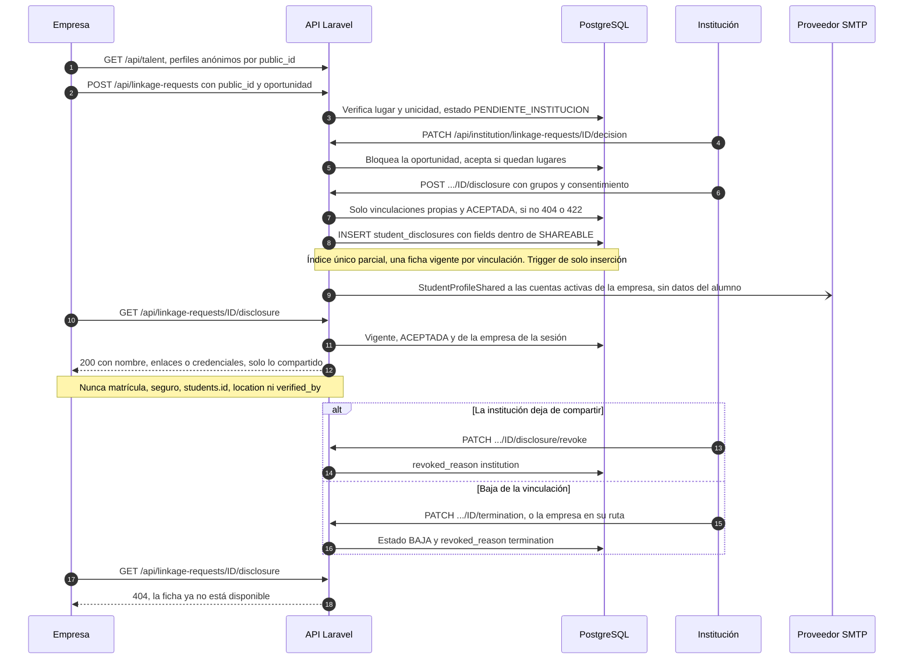

# Ficha compartida: lista blanca revocable

> **Estado:** pendiente de redacción (T-S20-04). [Índice de la documentación técnica](../README.md)

## Contenido previsto

- `StudentDisclosure::SHAREABLE` y los campos que nunca se comparten.
- Consentimiento, vigencia, revocación y bitácora de solo inserción.

## Vinculación y ficha compartida

## Fuentes en el repositorio

- `backend/app/Models/StudentDisclosure.php`
- `backend/app/Http/Controllers/StudentDisclosureController.php`
- `backend/app/Http/Controllers/Concerns/TerminatesLinkage.php`
- `backend/database/migrations/2026_11_25_000001_create_student_disclosures_table.php`
