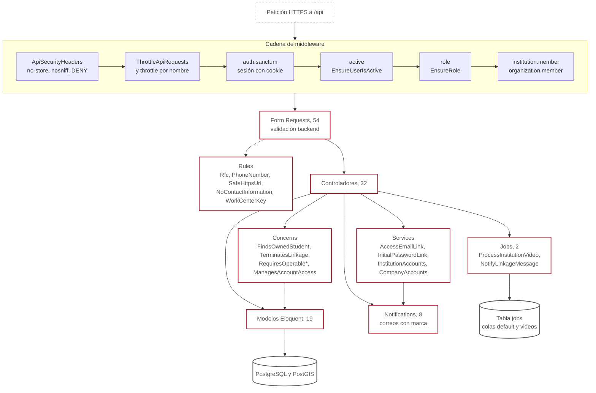

# Backend: arquitectura Laravel

[Índice de la documentación técnica](../README.md)

El backend es una aplicación Laravel 13 (PHP 8.4) que solo expone JSON. No tiene vistas web: las únicas plantillas son las de los correos (`resources/views/vendor/mail/`). Sigue la estructura estándar de Laravel, sin capas adicionales: la lógica que se repite vive en *Concerns* (traits), *Services* y *Support*.

## Componentes (C4 nivel 3)

| Capa | Contenido | Responsabilidad |
|---|---|---|
| Middleware | `ApiSecurityHeaders`, `ThrottleApiRequests`, `EnsureUserIsActive` (`active`), `EnsureRole` (`role`), `EnsureInstitutionMember` (`institution.member`), `EnsureOrganizationMember` (`organization.member`) | Cabeceras, límites, sesión, estado de la cuenta, rol y pertenencia ([matriz de permisos](../02-dominio-y-proceso/02-matriz-de-permisos.md)) |
| Form Requests | 54 clases en `app/Http/Requests/` | Validación de cada cuerpo y cada filtro, con mensajes en español |
| Rules | `Rfc`, `PhoneNumber`, `SafeHttpsUrl`, `NoContactInformation`, `WorkCenterKey` | Reglas de dominio reutilizables |
| Controladores | 32 clases (31 concretas y la base abstracta `SetupRoleAccountController`) | Un controlador por recurso y por rol cuando el contrato cambia; por ejemplo, `LinkageRequestController` para la empresa e `InstitutionLinkageRequestController` para la institución |
| Concerns | `FindsOwnedStudent`, `TerminatesLinkage`, `RequiresOperableCompany`, `RequiresOperableInstitution`, `ManagesAccountAccess` | Reglas compartidas entre controladores: pertenencia, baja de vinculación, perfil mínimo y gestión de cuentas |
| Services | `AccessEmailLink`, `InitialPasswordLink`, `InstitutionPasswordResetLink`, `InstitutionAccounts`, `CompanyAccounts` | Emisión de enlaces de un solo uso y alta de cuentas dentro de su organización |
| Modelos | 19 modelos Eloquent | Casts (`encrypted`, enums, fechas), relaciones y *scopes* |
| Enums | 14 en `app/Enums/` (`UserRole`, `LinkageRequestStatus`, `VideoStatus`…) | Valores cerrados, alineados con los `CHECK` de la base |
| Support | `MunicipalityCatalog`, `SkillCatalog`, `ContactInformation`, `CsvExport`, `InboxSearch`, `SocialSecurityNumber`, `Video\*`, `Simulation\*` | Utilidades de dominio sin estado |
| Jobs | `ProcessInstitutionVideo` (cola `videos`), `NotifyLinkageMessage` (cola `default`) | Trabajo asíncrono ([Colas y video](03-colas-y-video.md)) |
| Notifications | 8 correos con marca | [Correos transaccionales](04-correos-transaccionales.md) |
| Comandos de consola | `admin:bootstrap`, `admin:list`, `admin:reset-password`, `admin:update-email`, `auth:create-user`, `skills:seed`, `videos:webm`, `mail:preview`, `simulation:*` | Operación y recuperación de acceso desde el servidor |

## Ciclo de una petición

1. **Caddy** recibe la petición HTTPS. Las rutas `/api/*`, `/sanctum/*` y `/up` van a PHP-FPM, con un cuerpo de hasta 260 MB; el resto sirve la SPA.
2. **Middleware global:**
   - `ApiSecurityHeaders` agrega `Cache-Control: no-store, private` (salvo un `max-age` explícito de los medios firmados), `X-Content-Type-Options: nosniff`, `X-Frame-Options: DENY` y `Referrer-Policy: no-referrer`, también en las respuestas de error;
   - `statefulApi()` habilita la sesión y la protección CSRF de Sanctum para la SPA.
3. **Límite general** (`ThrottleApiRequests`). Las lecturas (`GET` y `HEAD`) no tienen límite. Las escrituras tienen 300 por minuto por cuenta autenticada, o 120 por minuto por IP sin sesión. El contador vive en la caché de archivos de la instancia.
4. **Middleware de la ruta:** `auth:sanctum` → `active` → `role:…` → `institution.member` u `organization.member` → límite con nombre (`throttle:…`).
5. **Form Request.** Valida el cuerpo y los filtros. El controlador usa solo `validated()`, así que un campo no declarado nunca llega al modelo. Además, 16 Form Requests responden `422` ante cualquier campo fuera de su lista (por ejemplo, un dato de la ficha que no está en `SHAREABLE`).
6. **Controlador:**
   - abre una transacción cuando hay varias escrituras;
   - bloquea con `FOR UPDATE` lo que puede competir (cupos de una oportunidad, estado de una solicitud, una cuenta);
   - filtra por la organización de la sesión.
7. **Respuesta.** Siempre es JSON, incluso en errores (`shouldRenderJsonWhen` devuelve `true`):
   - `401`: «No autenticado.»;
   - `403`: «No tienes permiso…»;
   - `419`: «La sesión expiró…»;
   - `404`: sin distinguir un recurso ajeno de uno inexistente;
   - `422`: errores de validación por campo, o un `code` de dominio como `COMPANY_PROFILE_INCOMPLETE`.

## Límites con nombre

Se definen en `AppServiceProvider` y se aplican además del límite general:

| Límite | Valor | Clave |
|---|---|---|
| `login` | 5/min por correo e IP, 20/min por IP | Correo e IP |
| `password-forgot` | 10/min por IP, 3/hora por correo | IP y hash del correo |
| `password-setup`, `password-reset` | 10/min por IP, 5/min por correo | IP y hash del correo |
| `email-confirm` | 10/min | IP |
| `talent-search` | 60/min | Cuenta |
| `linkage-messages` | 30/min | Cuenta |
| `linkage-requests`, `linkage-disclosure`, `uploads` | 20/min | Cuenta |
| `account-update`, `account-email`, `organization-profile`, `exports` y reenvíos o restablecimientos (`*-setup-resend`, `*-password-reset`) | 10/min | Cuenta |
| `account-password` | 5/min | Cuenta |

Los límites por correo usan el hash SHA-256 de la dirección, nunca la dirección en claro.

## Convenciones de implementación

- **Anti-IDOR.** Toda consulta de un recurso de organización filtra por la organización de la sesión, y un recurso ajeno responde `404` ([ADR-006](../01-vision-general/adr/ADR-006-privacidad-por-diseno.md)).
- **Identificadores acotados.** Las rutas restringen los IDs numéricos a `[1-9][0-9]{0,17}` y los UUID a su formato, así que un valor fuera de rango responde `404` sin llegar a PostgreSQL.
- **Sin `DELETE`.** Las bajas son lógicas (`PATCH …/status`).
- **Correo después del commit.** Los enlaces y avisos se envían en `DB::afterCommit` o desde la cola. Un fallo de envío se registra en el log sin deshacer la operación, y la respuesta informa si el enlace salió (`email_link_delivery: sent | pending`).
- **Salud.** `GET /up` (ruta de salud de Laravel) es lo primero que verifica la prueba de humo del despliegue.

## Fuentes en el repositorio

- `backend/bootstrap/app.php`
- `backend/app/Providers/AppServiceProvider.php`
- `backend/app/Http/Middleware/`, `backend/app/Http/Requests/`, `backend/app/Http/Controllers/`, `backend/app/Http/Controllers/Concerns/`
- `backend/app/Services/`, `backend/app/Rules/`, `backend/app/Support/`, `backend/app/Enums/`, `backend/app/Models/`
- `backend/app/Console/Commands/`
- `backend/routes/api.php`, `backend/routes/web.php`
- `infra/packer/files/caddy/Caddyfile`, `infra/scripts/smoke.sh`
