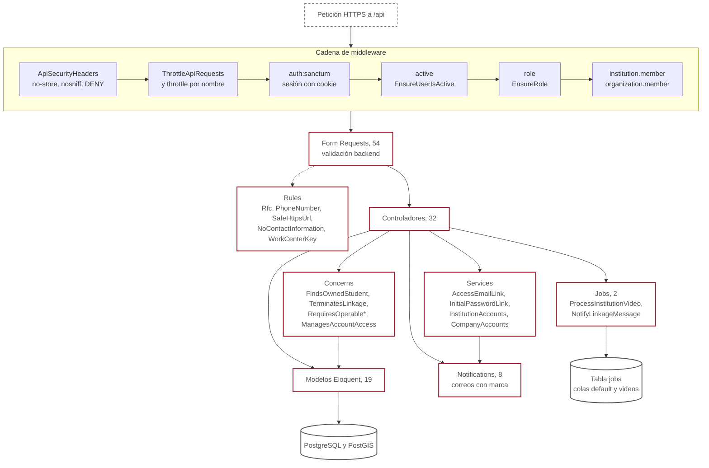

# Backend: arquitectura Laravel

> **Estado:** pendiente de redacción (T-S20-05). [Índice de la documentación técnica](../README.md)

## Contenido previsto

- Cadena de middleware, Form Requests, Concerns y Services.
- Anti-IDOR y cabeceras.

## Componentes del backend (C4 nivel 3)

## Fuentes en el repositorio

- `backend/bootstrap/app.php`
- `backend/app/Http/`
- `backend/app/Services/`
