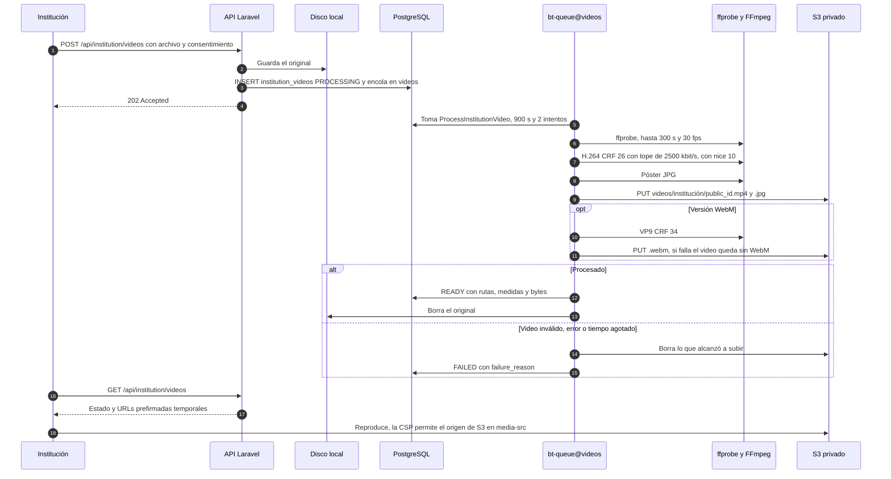

# Colas y procesamiento de video

> **Estado:** pendiente de redacción (T-S20-05). [Índice de la documentación técnica](../README.md)

## Contenido previsto

- Cola en base de datos con los workers `default` y `videos`.
- Parámetros de FFmpeg y manejo de fallos.

## Subida y transcodificación de video

## Fuentes en el repositorio

- `backend/app/Jobs/ProcessInstitutionVideo.php`
- `backend/app/Support/Video/VideoProcessor.php`
- `infra/packer/files/systemd/bt-queue@.service`
