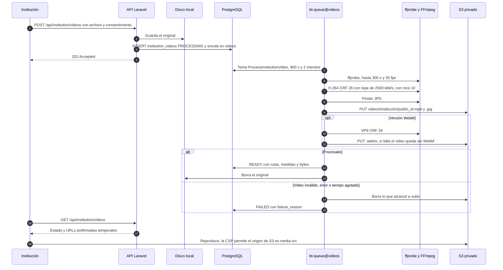

# Colas y procesamiento de video

[Índice de la documentación técnica](../README.md)

## Cola en base de datos

La cola usa PostgreSQL (`QUEUE_CONNECTION=database`, tablas `jobs` y `failed_jobs`), sin Redis ([ADR-001](../01-vision-general/adr/ADR-001-monolito-modular.md)):

| Parámetro | Valor | Por qué |
|---|---|---|
| `after_commit` | `true` | Un trabajo encolado dentro de una transacción solo existe si la transacción se confirma |
| `retry_after` | 960 s | Mayor que el `--timeout` del worker (900 s): un video que sigue en proceso no se entrega a otro worker |

Hay dos colas:

| Cola | Trabajos | Worker en el piloto | Worker en local |
|---|---|---|---|
| `videos` | `ProcessInstitutionVideo` | `bt-queue@videos.service` | Servicio `worker` de Compose: `queue:listen --queue=videos,default --timeout=900 --tries=2` |
| `default` | `NotifyLinkageMessage` y las notificaciones en cola (`AccessEmailChanged`, `PasswordChanged`) | `bt-queue@default.service` | El mismo servicio `worker` |

En el piloto, cada worker es una instancia de la unidad `bt-queue@.service`:
- ejecuta `artisan queue:work database --queue=%i --timeout=900 --tries=2 --max-time=3600 --sleep=3`;
- `--max-time` lo reinicia cada hora, para liberar memoria;
- separar las colas evita que un video largo retrase los correos.

`deploy-pilot.yml` detiene los dos workers antes de reemplazar la instancia y los reinicia después de migrar.

## Procesamiento de un video promocional

### Subida

`POST /api/institution/videos` (`throttle:uploads`):
1. Valida el archivo: MP4, MOV o WebM, hasta 250 MB. También valida el título, la descripción sin datos de contacto y el consentimiento de las personas que aparecen.
2. Guarda el original en el disco `local` de la instancia, porque FFmpeg necesita una ruta.
3. En una transacción:
   - bloquea la institución;
   - exige su perfil mínimo;
   - verifica la cuota de **5 videos activos** por institución;
   - inserta el registro en `PROCESSING`;
   - encola `ProcessInstitutionVideo` con `beforeCommit()`.

   En la cola de PostgreSQL, el trabajo se confirma junto con el video: nunca queda uno sin el otro.
4. Responde `202 Accepted`. Si algo falla, borra el original.

### Trabajo `ProcessInstitutionVideo`

| Parámetro | Valor |
|---|---|
| Cola | `videos` |
| `timeout` | 900 s, con `failOnTimeout` |
| `tries` | 2: el segundo intento solo cubre un worker que se detuvo a la mitad. Si el video ya no está en `PROCESSING`, el trabajo no hace nada. |
| Directorio de trabajo | Temporal, por video. Se borra siempre (`finally`). |

`App\Support\Video\VideoProcessor` define cada paso:

| Paso | Comando y parámetros |
|---|---|
| Inspección | `ffprobe` en JSON, con tope de 60 s. Rechaza archivos sin pista de video (una portada incrustada no cuenta), ilegibles o de **más de 300 s**. Corrige ancho y alto según la rotación del celular. Detecta HDR (PQ o HLG). |
| MP4 | H.264 (`libx264`, `-preset medium`, `-crf 26`, `-maxrate 2500k`, `-bufsize 5000k`) y AAC a 128 kbit/s estéreo. |
| Filtros del MP4 | HDR a SDR (`zscale` y `tonemap=hable`) cuando aplica. Lado corto a **720 px** como máximo, sin agrandar, con medidas pares. `fps=30` solo si el original tiene más. `yuv420p`. |
| Limpieza del MP4 | `-movflags +faststart` para reproducir antes de terminar la descarga. `-map_metadata -1` y `-map_chapters -1`: los videos de celular traen GPS, y se eliminan. `-threads 2`. |
| Póster | Un JPG del segundo 2, o de la mitad si el video dura menos de 4 s. |
| WebM (opcional) | VP9 (`libvpx-vp9`, `-crf 34`, `-b:v 0`, `-deadline good`, `-cpu-used 4`, `-row-mt 1`) y Opus a 96 kbit/s, a partir del MP4. Si falla, el video queda listo sin WebM y se registra un aviso. |
| Prioridad | Cada FFmpeg corre con `nice -n 10`, así la transcodificación no le quita CPU a la API. Cada uno tiene un tope de 870 s, por debajo del `timeout` del trabajo, para terminar con un motivo legible. |

**Resultado:**
- **Con éxito**, sube a `MEDIA_DISK` `videos/<institución>/<public_id>.mp4`, `.jpg` y, si se generó, `.webm`. Marca `READY` con rutas, duración, medidas y bytes, y borra el original.
- **Si falla** (video inválido, error o tiempo agotado), borra lo que alcanzó a subir y marca `FAILED` con un `failure_reason` en español que la institución ve. Si el trabajo se agota sin llegar a su propio manejo, `failed()` aplica el mismo cierre.

### Reproducción

- **Respuesta de la API.** El listado de la institución y la galería devuelven URLs prefirmadas temporales del MP4, el WebM y el póster ([Almacenamiento](../03-datos/02-almacenamiento-s3.md)).
- **Reproductor.** `VideoPlayer` usa el MP4 y recurre al WebM (`fallbackSrc`) solo si el navegador no decodifica H.264.
- **CSP.** Admite el origen del bucket en `media-src` e `img-src`.

### Operación

- **`php artisan videos:webm [--limit=N]`.** Genera la versión WebM de los videos que se procesaron antes de T-S14-18.
- **Memoria.** La instancia del piloto (`t4g.small`, 2 GB) tiene 2 GB de swap para absorber los picos de VP9 (ajuste A2 del plan del piloto).
- **Cambio de versión de FFmpeg.** Al pasar de FFmpeg 5.1 (Debian 12, imagen local) a 7.1 (Debian 13, AMI), el runbook exige una prueba real de video en el piloto.

## Aviso de mensajes nuevos: `NotifyLinkageMessage`

Cuando una parte escribe en la conversación de una vinculación aceptada, se encola un aviso para la otra parte con un **retraso de 5 minutos**. Al ejecutarse:
1. **Reclama el aviso** con un `UPDATE` condicional. Solo procede si:
   - la vinculación sigue `ACEPTADA`;
   - el destinatario no ha leído ese mensaje;
   - no hubo otro aviso en las **últimas 6 horas**.
2. **Envía `LinkageMessageReceived`** a las cuentas activas y ya activadas de la organización destinataria, con un enlace directo a la conversación. No envía nada si la organización está inactiva.
3. **Reintenta si el envío falla.** Libera el aviso reclamado y relanza el error, con 3 intentos y 60 s entre ellos.

Así, una conversación activa no llena el buzón: solo avisa de lo que sigue sin leerse.

## Fuentes en el repositorio

- `backend/config/queue.php`
- `backend/app/Jobs/ProcessInstitutionVideo.php`, `backend/app/Jobs/NotifyLinkageMessage.php`
- `backend/app/Support/Video/VideoProcessor.php`, `backend/app/Support/Video/MediaUrl.php`
- `backend/app/Http/Controllers/InstitutionVideoController.php` (`MAX_ACTIVE`, `ensureQuota`), `backend/app/Http/Controllers/LinkageMessageController.php`
- `backend/app/Http/Requests/StoreInstitutionVideoRequest.php`
- `backend/app/Console/Commands/GenerateVideoWebm.php`
- `infra/packer/files/systemd/bt-queue@.service`, `infra/packer/scripts/01-base.sh`
- `compose.yaml` (servicio `worker`), `.github/workflows/deploy-pilot.yml`
- `frontend/src/videos/` (`VideoPlayer` con `fallbackSrc`)
- `docs/infra/runbook-pilot.md` (prueba de video)
- `docs/infra/pilot-aws-plan.md` §1.1 y §6 (A2)
