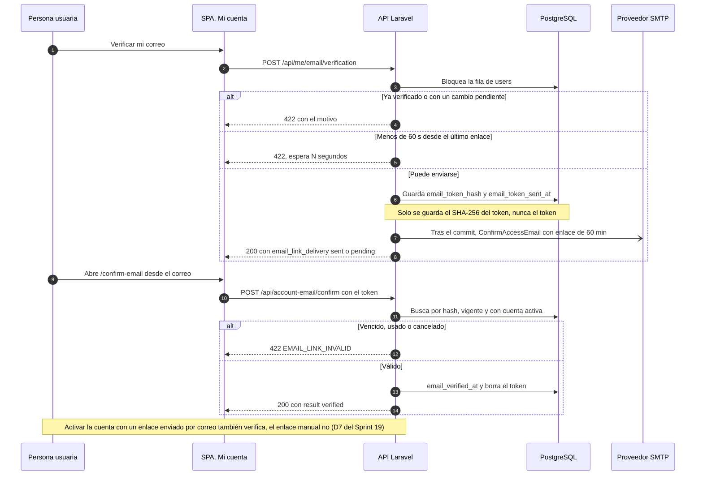
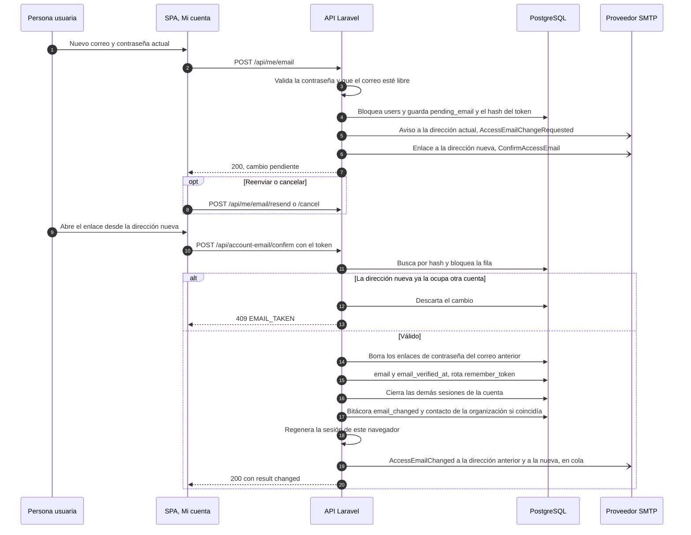

# Correos transaccionales con marca

> **Estado:** pendiente de redacción (T-S20-05). [Índice de la documentación técnica](../README.md)

## Contenido previsto

- Las 8 notificaciones, su entrega inmediata o en cola, y la plantilla con marca.
- Verificación y cambio del correo de acceso.

## Verificación del correo de acceso

## Cambio del correo de acceso

## Fuentes en el repositorio

- `backend/app/Notifications/`
- `backend/resources/views/vendor/mail/`
- `backend/app/Services/AccessEmailLink.php`
- `backend/app/Http/Controllers/AccountEmailController.php`
