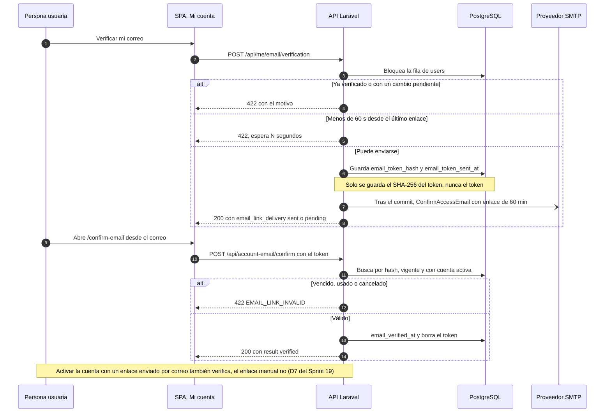
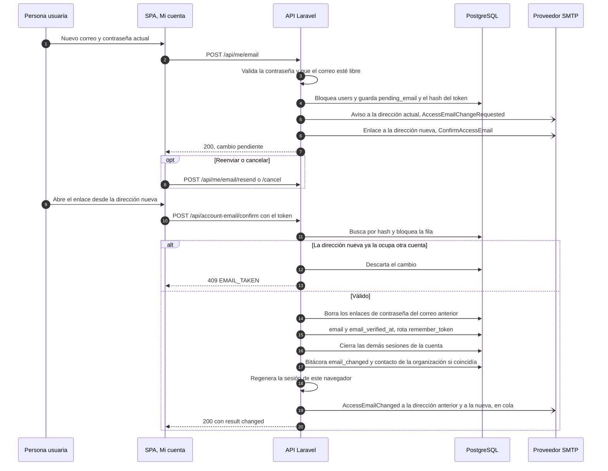

# Correos transaccionales con marca

[Índice de la documentación técnica](../README.md)

La plataforma no envía correos masivos ni de mercadotecnia. Cada correo responde a una acción sobre una cuenta o una vinculación. Todos usan la misma plantilla con marca (T-S18-05) y salen por SMTP:
- **en el piloto**, por Resend (`MAIL_SCHEME=smtps`, puerto 465), con un host configurable desde Terraform y SSM;
- **en local y en las pruebas E2E**, Mailpit los captura.

## Las 8 notificaciones

| Notificación | Cuándo | Destinatario | Entrega |
|---|---|---|---|
| `SetInitialPassword` | Al invitar una cuenta con entrega por correo, o al reenviar el enlace | La persona invitada | Inmediata, después del commit |
| `ResetInstitutionPassword` | Un `ADMIN` o `SECRETARY` inicia un restablecimiento, o la persona usa «Olvidé mi contraseña» | El titular de la cuenta | Inmediata, después del commit («Olvidé mi contraseña»: después de responder) |
| `PasswordChanged` | La persona cambia su contraseña en Mi cuenta | El titular | En cola (`afterCommit`) |
| `ConfirmAccessEmail` | Verificar el correo actual, o confirmar un correo nuevo | La dirección que se va a verificar | Inmediata, después del commit |
| `AccessEmailChangeRequested` | Se pidió cambiar el correo de acceso | La dirección **actual**, como aviso de seguridad | Inmediata, después del commit |
| `AccessEmailChanged` | Se confirmó el cambio de correo | La dirección **anterior** y la **nueva** | En cola (`afterCommit`) |
| `LinkageMessageReceived` | Hay mensajes sin leer de la otra parte de una vinculación | Las cuentas activas de la organización destinataria | En cola: trabajo `NotifyLinkageMessage`, 5 minutos después y como máximo uno cada 6 horas ([Colas](03-colas-y-video.md#aviso-de-mensajes-nuevos-notifylinkagemessage)) |
| `StudentProfileShared` | La institución comparte la ficha del alumno | Las cuentas activas de la empresa | Inmediata, después del commit ([Ficha compartida](../03-datos/03-ficha-compartida.md)) |

**Reglas comunes:**
- **Después del commit.** Ningún correo sale de una transacción que no se confirmó: se usan `DB::afterCommit`, `afterCommit()` en las notificaciones en cola y `after_commit` en la cola.
- **Un fallo de envío no deshace la operación.** Se registra en el log con el tipo de excepción, sin el correo ni el token. Cuando el usuario necesita saberlo, la respuesta lo indica: `email_link_delivery` es `sent` o `pending`, o el enlace manual queda disponible para entregarlo a mano.
- **Ningún correo lleva datos del alumno.** Los avisos de mensajes y de ficha solo nombran a la organización y la oportunidad, y enlazan a la plataforma, donde se exige sesión.
- **Los enlaces van a la SPA** (`FRONTEND_URL`). La SPA llama a la API con el token.

## Enlaces de un solo uso

| Enlace | Almacenamiento | Vigencia |
|---|---|---|
| Establecer contraseña | Broker `institution_setup` (`institution_password_setup_tokens`): token con hash, por correo | 60 minutos, reenvío como máximo cada 60 s |
| Restablecer contraseña | Broker `institution_reset` (`institution_password_reset_tokens`) | 60 minutos, reenvío como máximo cada 60 s |
| Verificar o cambiar el correo de acceso | `users.email_token_hash` (SHA-256 del token de 64 caracteres) y `email_token_sent_at` | 60 minutos (`AccessEmailLink::MINUTES`), reenvío como máximo cada 60 s |

Los brokers conservan el nombre `institution_*` de cuando solo existían cuentas institucionales; hoy sirven a los cuatro roles. Ninguna tabla guarda un token en claro.

## Verificación del correo de acceso

Un correo sin verificar **no bloquea** el inicio de sesión (D6 del Sprint 19): la interfaz muestra una etiqueta y un aviso.

El correo queda verificado de dos formas:
- al establecer la contraseña con un enlace que **llegó por correo** (no con uno entregado a mano, D7);
- con el flujo de verificación.

- `POST /api/me/email/verification` exige que el correo no esté verificado y que no haya un cambio pendiente. Respeta la espera de 60 s entre envíos.
- `POST /api/account-email/confirm` no exige sesión:
  - busca la cuenta por el hash del token, con bloqueo de fila;
  - exige que el enlace esté vigente y la cuenta activa;
  - un enlace vencido, usado o cancelado responde `422 EMAIL_LINK_INVALID`, sin revelar cuál fue el caso.

## Cambio del correo de acceso

Solo la persona titular cambia su correo, desde Mi cuenta, con su contraseña actual. Los administradores solo pueden corregir el correo de cuentas **pendientes de activar** (T-S19-02). Para recuperar el acceso, la consola tiene `admin:update-email`, que aplica el cambio de inmediato y deja el correo sin verificar (D9).

**Al confirmar el cambio, en una sola transacción:**
1. **Si la dirección nueva ya la ocupa otra cuenta**, el cambio se descarta y responde `409 EMAIL_TAKEN`. El correo no cambia.
2. Se borran los enlaces de contraseña pendientes, que estaban ligados a la dirección anterior.
3. Se actualiza el correo, se marca verificado y se rota `remember_token`.
4. Se cierran **las demás sesiones** de la cuenta. La del navegador que confirma, si es de la misma cuenta, se conserva y se regenera.
5. Se registra `email_changed` en la bitácora.
6. **Contacto de la organización (D8).** Si coincidía con la dirección anterior, se actualiza también y se registra `organization_profile_updated`.

**Después del commit**, `AccessEmailChanged` avisa a la dirección anterior y a la nueva.

## Plantilla con marca

- **Tema.** La plantilla es el Markdown de Laravel con el tema `banco-talentos` (`config('mail.markdown.theme')`):
  - `resources/views/vendor/mail/html/themes/banco-talentos.css`: vino `#991B30` en títulos, enlaces y botón, grafito `#57565B` en el texto y dorado `#B99058` solo en el filete superior de la tarjeta;
  - Laravel convierte esas reglas en estilos en línea, que es lo que respetan Gmail y Outlook.
- **Encabezado.** `html/header.blade.php` muestra el logotipo desde una URL pública (`MAIL_LOGO_URL` o `FRONTEND_URL/brand/logo-correo.png`). `scripts/brand/build-mail-logo.py` genera esa imagen.
- **Texto plano.** Cada correo tiene también su versión en texto plano (`text/message.blade.php`).
- **Vista previa.** `php artisan mail:preview` genera los correos con datos de ejemplo, para revisarlos sin enviarlos.

## Fuentes en el repositorio

- `backend/app/Notifications/` (8 clases)
- `backend/app/Services/AccessEmailLink.php`, `InitialPasswordLink.php`, `InstitutionPasswordResetLink.php`
- `backend/app/Http/Controllers/AccountEmailController.php`, `AccountController.php`, `PasswordForgotController.php`
- `backend/app/Http/Requests/RequestAccessEmailChangeRequest.php`
- `backend/app/Jobs/NotifyLinkageMessage.php`, `backend/app/Http/Controllers/StudentDisclosureController.php`
- `backend/config/auth.php` (`passwords`), `backend/config/mail.php` (`markdown.theme`, `logo_url`)
- `backend/resources/views/vendor/mail/`, `scripts/brand/build-mail-logo.py`
- `backend/app/Console/Commands/PreviewMail.php`, `AdminUpdateEmail.php`
- `docs/sprint-18.md` (T-S18-05), `docs/sprint-19.md` (D6 a D9, T-S19-01 a T-S19-04)
