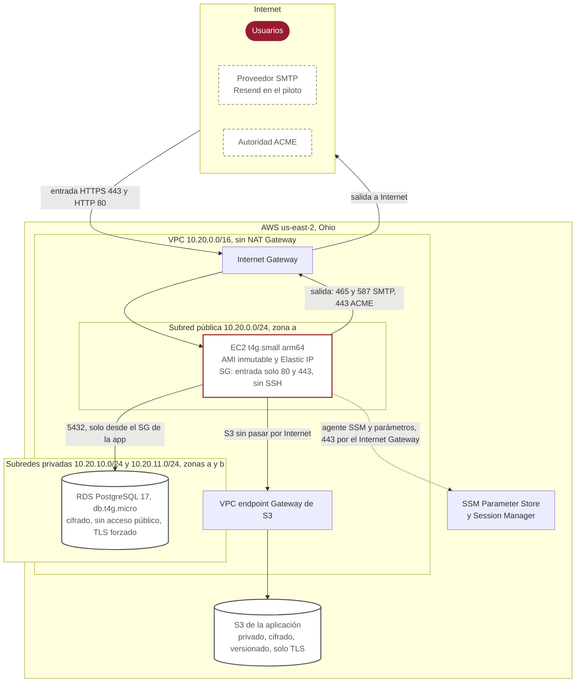

# Topología AWS

[Índice de la documentación técnica](../README.md)

El piloto vive en la región **`us-east-2` (Ohio)**, porque la cuenta del Plan Gratuito quedó asignada ahí (D1 del plan del piloto). Todo se declara en `infra/terraform/envs/pilot/` con los módulos `network`, `storage`, `compute`, `database` y `params` ([Terraform](03-terraform.md)). El DNS es externo (Hostinger): Terraform no crea zonas de Route 53, y el registro A del subdominio apunta a la Elastic IP.

La decisión de prescindir del NAT Gateway, y el contraste entre la salida por el Internet Gateway y el endpoint de S3, están en el [ADR-004](../01-vision-general/adr/ADR-004-vpc-sin-nat.md).

## Recursos

| Módulo | Recurso | Configuración |
|---|---|---|
| `network` | VPC | `10.20.0.0/16`. Una subred pública `10.20.0.0/24` en la primera zona, con ruta `0.0.0.0/0` al Internet Gateway. Dos subredes privadas `10.20.10.0/24` y `10.20.11.0/24` en dos zonas, solo con la ruta local. Un VPC endpoint Gateway de S3, asociado a la tabla de rutas pública. Sin NAT. |
| `compute` | EC2 | `t4g.small` (arm64, Graviton), créditos de CPU `standard`, AMI de la versión. IP pública con Elastic IP. IMDSv2 obligatorio. Disco raíz gp3 de 30 GB cifrado, con 2 GB de swap. `auto_recovery = "default"`. Se reemplaza con `create_before_destroy` cuando cambian la AMI o el `user_data`. |
| `compute` | Grupo de seguridad de la aplicación | Entrada solo por 80 y 443 (IPv4 e IPv6), sin SSH. Salida por 443, 80, 465, 587 y 5432 (este último solo hacia la VPC). |
| `compute` | Rol IAM de la instancia | `AmazonSSMManagedInstanceCore` (Session Manager y Run Command). Lectura de `/banco-talentos/pilot/*` en Parameter Store, con descifrado mediante la llave administrada de SSM. `GetObject`, `PutObject` y `DeleteObject` sobre los objetos del bucket, y `ListBucket`. |
| `database` | RDS PostgreSQL | Versión 17 con actualizaciones menores automáticas, `db.t4g.micro`, 20 GB gp3 cifrados, sin acceso público y `multi_az = false`. Grupo de parámetros con `rds.force_ssl = 1`. Respaldos de 7 días, a las 08:00 UTC (02:00 en la Ciudad de México). Mantenimiento los domingos de 08:30 a 09:30 UTC. Protección contra borrado activa y snapshot final. |
| `database` | Grupo de seguridad de la base | Entrada por 5432 solo desde el grupo de seguridad de la aplicación |
| `storage` | Bucket S3 `banco-talentos-pilot-<cuenta>` | Privado, cifrado y versionado; solo TLS ([Almacenamiento](../03-datos/02-almacenamiento-s3.md)) |
| `params` | SSM Parameter Store `/banco-talentos/pilot/*` | Configuración de Laravel en `String` y `DB_PASSWORD` en `SecureString`. `APP_KEY` y `MAIL_PASSWORD` se cargan a mano y nunca pasan por Terraform. |

## Flujos de red

| Origen → destino | Camino | Puertos |
|---|---|---|
| Usuarios → EC2 | Internet → Internet Gateway → subred pública | 443 (y 80 para redirigir a HTTPS) |
| EC2 → RDS | Dentro de la VPC, entre grupos de seguridad | 5432, con TLS obligatorio |
| EC2 → S3 | VPC endpoint Gateway, sin salir a Internet | 443 |
| EC2 → SMTP (Resend) | Internet Gateway | 465 (`smtps`) |
| EC2 → autoridad ACME | Internet Gateway | 443 |
| EC2 → SSM (agente, parámetros) | Internet Gateway, porque no hay endpoints de interfaz | 443 |
| Administración humana | Session Manager desde la consola o la CLI de AWS, sin SSH | — |
| GitHub Actions → AWS | API de AWS con credenciales OIDC temporales ([ADR-005](../01-vision-general/adr/ADR-005-oidc-github-aws.md)) | — |

## Salidas de Terraform

`envs/pilot/outputs.tf` expone `public_ip`, `domain_a_record`, `instance_id`, `bucket`, `db_endpoint`, `ssm_path` y `app_url`. `deploy-pilot.yml` usa `instance_id` y `app_url` para drenar, migrar y verificar.

## Fuentes en el repositorio

- `infra/terraform/envs/pilot/` (`main.tf`, `variables.tf`, `outputs.tf`, `versions.tf`, `pilot.tfvars.example`)
- `infra/terraform/modules/network/main.tf`, `compute/main.tf`, `database/main.tf`, `storage/main.tf`, `params/main.tf`
- `infra/packer/scripts/01-base.sh` (swap)
- `docs/infra/pilot-aws-plan.md` §3 y §6 (D1 a D5, A1 a A4)
