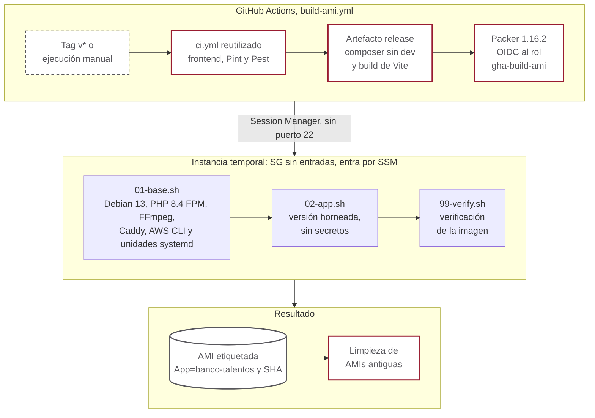

# AMI inmutable con Packer

[Índice de la documentación técnica](../README.md)

Cada versión de la aplicación se hornea en una AMI con `infra/packer/banco-talentos.pkr.hcl` ([ADR-002](../01-vision-general/adr/ADR-002-packer-terraform.md), [ADR-003](../01-vision-general/adr/ADR-003-infraestructura-inmutable.md)). La AMI contiene el sistema, los servicios y el código. **No contiene secretos ni configuración del entorno**: esos llegan al arrancar desde SSM.

## Fuente y construcción

| Elemento | Valor |
|---|---|
| Imagen base | La más reciente de `debian-13-arm64-*`, de la cuenta oficial de Debian (`136693071363`) |
| Arquitectura | `arm64` por omisión. La variable `arch` admite `x86_64` para instancias `t3`. |
| Instancia de construcción | `t4g.small`, con el perfil `banco-talentos-packer-build` (solo `AmazonSSMManagedInstanceCore`, sin acceso a Parameter Store) y un grupo de seguridad **sin reglas de entrada**, ambos creados por `bootstrap/` |
| Conexión | SSM Session Manager. El `user_data` de la fuente instala `amazon-ssm-agent` con la arquitectura detectada antes de conectarse (ajuste A1). El puerto 22 no se abre ni durante la construcción. |
| Entradas | `release_sha` (SHA del commit, validado como hexadecimal) y `artifact_path` (`release-<sha>.tar.gz` armado por `build-ami.yml`). La carpeta `files/` viaja como `bt-files.tar.gz`, porque un directorio no sube por el túnel de Session Manager. |
| Salida | AMI etiquetada con `App=banco-talentos` y la versión, y `packer-manifest.json` con su ID |

## Aprovisionamiento

| Script | Qué hace |
|---|---|
| `scripts/01-base.sh` | Instala, desde Debian 13 y sin repositorios de terceros, PHP 8.4 (FPM, CLI, OPcache, `pgsql`, `intl`, `zip`, `mbstring`, `xml`, `curl` y `bcmath`), FFmpeg con `libx264`, `libvpx-vp9` y `libopus`, `jq` y utilidades. Instala Caddy desde su repositorio oficial. Crea 2 GB de swap persistente (A2). Instala el `Caddyfile`, la configuración de PHP, los scripts `bt-*` y las unidades systemd, y las habilita. |
| `scripts/02-app.sh` | Extrae la versión en `/opt/banco-talentos/releases/<sha>`, propiedad de `root` y de solo lectura. Enlaza `storage/` y `bootstrap/cache/` a `/var/lib/banco-talentos/` (`www-data`) y `.env` a `/run/banco-talentos/.env`. Apunta `/opt/banco-talentos/current` a la versión y escribe `RELEASE`. |
| `scripts/99-verify.sh` | Falla la construcción si algo no cumple (ver abajo) |

**Qué exige `99-verify.sh`:**
- **Sin configuración horneada:**
  - ningún `.env` en la imagen;
  - `.env` apunta a `/run`, que no existe durante la construcción;
  - ninguna caché de Laravel horneada;
  - ningún `instance.env`.
- **PHP:** 8.4 con todas sus extensiones y OPcache; `php-fpm8.4 -t` válido.
- **Herramientas:** `ffprobe` y `nice` presentes; `artisan` arranca.
- **Servicios:** `caddy validate` pasa y `amazon-ssm-agent` está habilitado.

## Configuración horneada

| Archivo | Contenido |
|---|---|
| `files/caddy/Caddyfile` | HTTPS automático, cabeceras de seguridad, CSP, `/api`, `/sanctum` y `/up` hacia PHP-FPM, y la SPA con caché inmutable en `/assets/*` ([Tokens y CSP](../05-frontend/03-tokens-y-csp.md)) |
| `files/php/zz-banco-talentos.ini` | `upload_max_filesize=250M`, `post_max_size=260M`, `memory_limit=256M`, `expose_php=Off`, OPcache con `validate_timestamps=0` (el código no cambia en la instancia) |
| `files/php/www.conf` | Pool de PHP-FPM |
| `files/sbin/bt-boot.sh` | Arranque: lee SSM, escribe `.env` y `caddy.env`, restaura los certificados, prepara las cachés y entra en mantenimiento si hay migraciones pendientes |
| `files/sbin/bt-artisan` | `php artisan` como `www-data` |
| `files/sbin/bt-caddy-certs.sh` | Respaldo y restauración de los datos de Caddy en `s3://<bucket>/caddy/` |
| `files/systemd/` | `bt-boot.service`, `bt-queue@.service` (instancias `videos` y `default`), `bt-schedule.service` y `.timer` (cada minuto), `bt-caddy-certs.service` y `.timer` (30 minutos después del arranque y luego cada día), y *overrides* de `caddy` y `php8.4-fpm` para que arranquen después de `bt-boot` |

## Ciclo de vida de las AMIs

- **Disparadores.** `build-ami.yml` corre al publicar un tag `v*` o de forma manual. Su job de Packer usa el entorno `pilot`, que exige aprobación del responsable.
- **Limpieza.** Al terminar se conservan las **3 AMIs más recientes** y cualquiera que use una instancia; las demás se borran junto con sus snapshots.
- **Despliegue.** **Deploy pilot** toma la AMI indicada o, si no se indica, la más reciente con `App=banco-talentos`.

## Fuentes en el repositorio

- `infra/packer/banco-talentos.pkr.hcl`
- `infra/packer/scripts/01-base.sh`, `02-app.sh`, `99-verify.sh`
- `infra/packer/files/` (`caddy/`, `php/`, `sbin/`, `systemd/`, `ssm-agent-userdata.sh`)
- `.github/workflows/build-ami.yml`
- `infra/terraform/bootstrap/main.tf` (perfil y grupo de seguridad de construcción)
- `docs/infra/pilot-aws-plan.md` §2 y §6 (A1 a A4)
