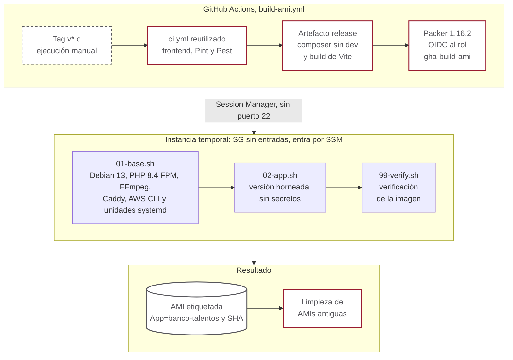

# AMI inmutable con Packer

> **Estado:** pendiente de redacción (T-S20-06). [Índice de la documentación técnica](../README.md)

## Contenido previsto

- Plantilla, scripts de aprovisionamiento y unidades systemd.

## Construcción de la AMI

## Fuentes en el repositorio

- `infra/packer/banco-talentos.pkr.hcl`
- `infra/packer/scripts/`
- `infra/packer/files/`
- `.github/workflows/build-ami.yml`
