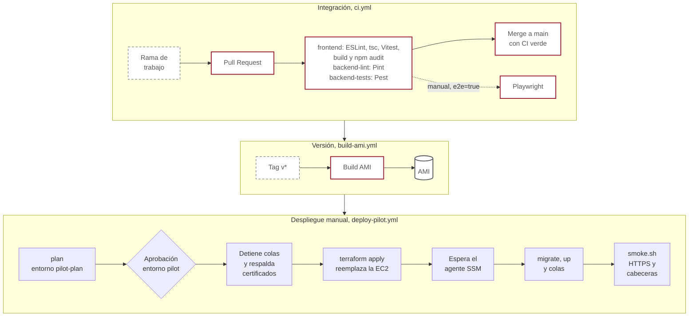
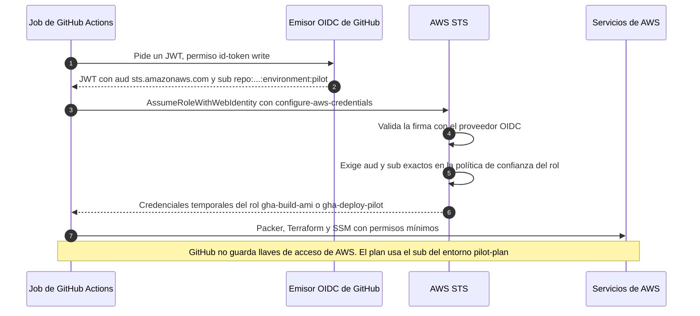

# GitHub Actions y CI/CD

> **Estado:** pendiente de redacción (T-S20-06). [Índice de la documentación técnica](../README.md)

## Contenido previsto

- Los 3 workflows, entornos con aprobación, acciones fijadas por SHA.

## Pipeline de CI/CD

## Federación OIDC con AWS

## Fuentes en el repositorio

- `.github/workflows/ci.yml`
- `.github/workflows/build-ami.yml`
- `.github/workflows/deploy-pilot.yml`
- `infra/terraform/bootstrap/main.tf`
