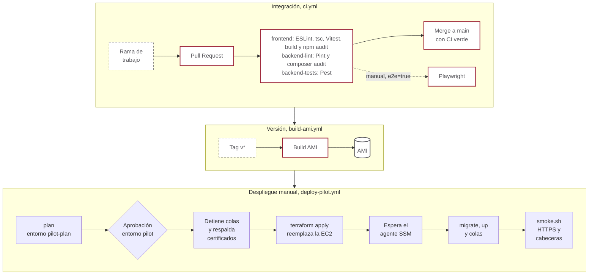
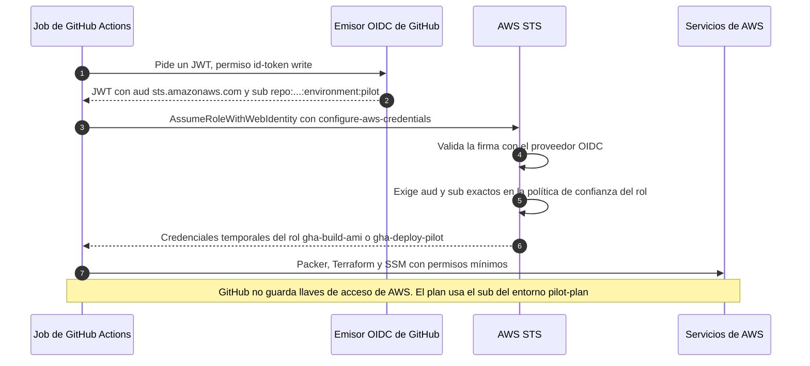

# GitHub Actions y CI/CD

[Índice de la documentación técnica](../README.md)

Tres workflows en `.github/workflows/` llevan un cambio desde el PR hasta el piloto. Todos:
- corren en `ubuntu-24.04`;
- declaran `permissions: contents: read` por omisión;
- fijan cada acción por SHA del commit;
- hacen el `checkout` con `persist-credentials: false`.

## `ci.yml`: integración continua

**Disparadores:** cada `pull_request`, cada `push` a `main`, `workflow_call` (lo reutiliza `build-ami.yml`) y `workflow_dispatch`. La concurrencia cancela una ejecución anterior de la misma rama.

| Job | Pasos | Límite |
|---|---|---|
| `frontend` | `npm ci`, `npm run lint` (ESLint), `npx tsc -b`, `npx vitest run`, `npm run build` y `npm audit --audit-level=high`, con Node 24 y caché de npm | 20 min |
| `backend-lint` | `composer install`, `composer lint` (Pint en modo `--test`) y `composer audit`, con PHP 8.4 | 15 min |
| `backend-tests` | `sh scripts/test-backend.sh`: Pest con PostgreSQL 17 + PostGIS 3.5 en `tmpfs` (`compose.testing.yaml`), el mismo camino que en local | 45 min |
| `e2e` | `sh scripts/test-e2e.sh` (Playwright con la API real y Mailpit). **Solo** en ejecución manual con `e2e=true` y **después** de `backend-tests`, porque comparten el proyecto de Compose `banco-talentos-tests`. | 60 min |

Antes de Pest y de E2E se crea un `backend/.env` vacío. Sin él, phpdotenv deja un aviso en cada prueba que PHPUnit cuenta como *warning*. Las variables reales vienen de `compose.testing.yaml` y `phpunit.xml`.

## `build-ami.yml`: construir una versión

**Disparadores:** tags `v*` y `workflow_dispatch`. La concurrencia es serial y no cancela.

1. **`ci`.** Reutiliza `ci.yml` completo: no se construye una versión sin pruebas en verde.
2. **`artifact`:**
   - `composer install --no-dev --optimize-autoloader --classmap-authoritative`;
   - `npm ci` y `npm run build`;
   - arma `release-<sha>.tar.gz` sin `tests`, `storage`, `.env*`, cachés ni `phpunit.xml`, y **falla si encuentra algún `.env`**;
   - lo publica como artefacto de 7 días.
3. **`packer`** (entorno `pilot`, que exige aprobación):
   - asume el rol `gha-build-ami` por OIDC;
   - instala Packer 1.16.2 y el plugin de Session Manager;
   - `packer init`, `fmt -check`, `validate` y `build`;
   - publica el ID de la AMI en el resumen del job y limpia las AMIs antiguas (conserva las 3 más recientes y las que estén en uso).

El detalle de la imagen está en [AMI inmutable con Packer](02-packer.md).

## `deploy-pilot.yml`: desplegar una AMI

**Disparador:** solo `workflow_dispatch`, con `ami_id` opcional (vacío = la más reciente con `App=banco-talentos`). La concurrencia es serial y no cancela, así que nunca corren dos despliegues a la vez.

| Job | Entorno | Pasos |
|---|---|---|
| `plan` | `pilot-plan` (solo `main`) | OIDC con el rol de despliegue → `terraform init` con el backend S3 → `fmt -check -recursive`, `validate` y `plan` → resumen del plan en el job |
| `apply` | `pilot` (**aprobación del responsable**, solo `main` y tags `v*`) | 1. **Drenar:** si la instancia actual usa otra AMI, detiene `bt-queue@videos` y `bt-queue@default` y fuerza el respaldo de certificados, por SSM (`ssm-run.sh`). 2. `terraform apply` (reemplaza la EC2 y reasocia la EIP). 3. Espera a que la instancia nueva aparezca en SSM (`wait-ssm-online.sh`). 4. Por SSM: `bt-artisan migrate --force`, `bt-artisan up` y reinicio de las colas. 5. `smoke.sh`: `/up`, cabeceras, `401` con `no-store` y redirección a HTTPS. 6. Resumen. |

Las migraciones se ejecutan sin `--isolated`: su candado vive en la caché de base de datos, cuya tabla todavía no existe en el primer despliegue.

## Federación OIDC

Las condiciones exactas de la política de confianza, los dos roles y el sujeto inmutable están en el [ADR-005](../01-vision-general/adr/ADR-005-oidc-github-aws.md).

## Entornos y variables de GitHub

| Entorno | Protección | Variables |
|---|---|---|
| `pilot-plan` | *Deployment branches*: solo `main` | `AWS_DEPLOY_ROLE_ARN`, `TF_STATE_BUCKET`, `PILOT_DOMAIN` y `PILOT_ACME_EMAIL` |
| `pilot` | *Required reviewers* (el responsable), solo `main` y tags `v*` | Las mismas, más `AWS_BUILD_AMI_ROLE_ARN` y `PACKER_SECURITY_GROUP_ID` |

Son ARNs y nombres, no credenciales: el repositorio no guarda secretos de AWS.

## Notas operativas del flujo de PRs

- **Cambiar la base de un PR no relanza el CI.** Al redirigir un PR apilado a `main` (por ejemplo, el #12 del Sprint 19, que estaba sobre el #11), GitHub no ejecuta `ci.yml` de nuevo. Antes de fusionar se comprueba con `git merge-tree --write-tree` que el árbol resultante sea idéntico al que ya pasó su CI, o se lanza `ci.yml` a mano.
- **La salida de las migraciones no aparece en el log del workflow.** `gh run view --log` no muestra lo que imprime `migrate` dentro de la instancia. Para confirmar que una migración corrió se consulta por SSM: `aws ssm start-session` y `sudo bt-artisan migrate:status`. Así se verificaron las dos migraciones del Sprint 19 (lote 2).
- **Un Sprint puede no desplegar.** Los Sprints 18 y 19 se fusionaron por separado y se desplegaron con una sola ejecución de **Build AMI** y otra de **Deploy pilot**.

## Fuentes en el repositorio

- `.github/workflows/ci.yml`, `.github/workflows/build-ami.yml`, `.github/workflows/deploy-pilot.yml`
- `infra/scripts/ssm-run.sh`, `infra/scripts/wait-ssm-online.sh`, `infra/scripts/smoke.sh`
- `scripts/test-backend.sh`, `scripts/test-e2e.sh`, `compose.testing.yaml`
- `infra/terraform/bootstrap/main.tf`
- `docs/infra/runbook-pilot.md` §4 (entornos de GitHub)
- `docs/sprint-17.md` (T-S17-08, T-S17-09), `docs/sprint-19.md` (Cierre y despliegue)
